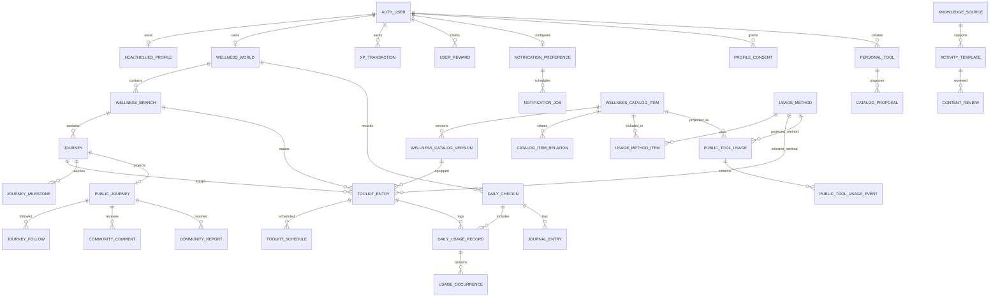

## MP17 bilingual recommendation snapshot and legacy World read compatibility — 2026-11-02

New validated AI goals may carry `localizedRecommendation` nested on each goal inside the existing `healthclues_profiles.profile.wellnessPlans` JSONB revision. The server extracts this snapshot only from a valid profile-bound signed Advisor proof, after the selected option is verified. It preserves canonical goal ID and A/B/Custom Plan fields. This is an application-level JSON object, not a database column; no migration or new table is required. Historical one-locale goals without the snapshot remain intact and display their saved text as-is. User-authored text is never auto-translated.

The authenticated `/api/healthclues/world` read for check-in history now selects only columns present in `healthclues_daily_usage_records`; `local_date` is owned by the check-in record, not the usage record. My Journey can also classify a legacy equipped entry with `slot_key=practice` and no `discovery_station` as a Practice, without rewriting its stored row. Current isolated Chromium verification is in `reports/HEALTHCLUES_MASTER_PROMPT_17_ACCEPTANCE.md`. This records local behavior only; it does not prove production schema state or original 96-answer retention.

## Handoff note preservation clarification (2026-10-31)

The short-lived `hc-pending-journey` encrypted HttpOnly cookie keeps a bounded optional `originalNote` (≤180 chars) inside a confirmed user's Plan item across email verification. The validator rejects wrong type/oversize input and preserves the exact trimmed note; it does not add a table or write guest data to the database. After verified same-email activation, the existing World-scoped versioned JSON Plan remains canonical. Browser acceptance on local build 3269 verified the note in the saved profile Plan. No migration was applied.

## Wellness Plan Phase 10A — mô hình dữ liệu (2026-10-30)

Tái sử dụng healthclues_profiles.profile JSONB đã có: thuộc tính wellnessPlans giữ các revision có worldId, requestKey, version, confirmedAt và goals. POST/GET /api/healthclues/plan yêu cầu phiên xác thực; POST kiểm tra email xác minh, World thuộc auth.id, revision Catalog đang active/reviewed và demo-only chỉ ở Owner Demo, rồi giữ lịch sử giới hạn 40 revision. GET /api/healthclues/world chỉ trả bản mới nhất cho World hiện tại để Camp hiển thị Daily Care preview. Không thêm migration; lịch sử cũ không bị ghi đè. Pending plan ở guest dùng cookie AES-GCM HttpOnly 20 phút hiện hữu, không URL/localStorage.

**Giới hạn cần nghiệm thu:** JSONB profile PATCH chưa có transaction/RPC cho idempotency đồng thời; key ngăn gửi lặp tuần tự, chưa chứng minh race hai request đồng thời. DB round-trip và RLS qua service path chưa được browser-test trong Phase 10A vì Docker identity check bị từ chối; không ghi nhận là PASS.

Additional local-only migration `20261030140000_healthclues_mailpit_reminder_delivery.sql` adds service-role-only atomic claim/finish RPCs for the retained reminder queue. Owner Demo alone enables `mailpit` provider mode; claims include only verified email + active consent, and responses/status store opaque provider ID/error code. No health topic is included in email or delivery metadata. The production scheduler/provider remains unconfigured. A process crash during an in-flight claim can leave a row claimed; automatic recovery is intentionally not yet enabled because SMTP/HTTP send acceptance may be ambiguous.

## Current additive persistence mapping — 2026-10-30
Nickname uses the existing authenticated `healthclues_profiles.profile` JSONB, preserving existing Quiz fields. Guide progress uses existing `healthclues_player_guide_state`; additive local migration `20261030130000_healthclues_guided_summary_reminders.sql` extends the allowed stage values for summary/reminder steps and is applied only to the retained local Owner Demo. Reminder preferences/queue/delivery continue using existing tables and RLS; `20261030140000_healthclues_mailpit_reminder_delivery.sql` adds only service-role claim/finish functions for local Mailpit dispatch. No new private-health table was introduced. See local-only migration evidence and release limitations in `CURRENT_STATE.md`.
# Database Design (logical proposal; dated addenda record actual local migrations)

## Universal Wellness Plan storage clarification (2026-10-30)

Verification update: local Chromium E2E created one plan revision in each of two separate synthetic Worlds, verified the same owner/World/revision after reload, and verified cross-owner Plan read/write rejection (404). No migration or second plan table was introduced. Email-verification callback on port 3261 remains untested.

The universal advisor reuses the existing authenticated profile JSONB revision model attached to the existing World; it does not add a topic-specific plan table or migration. Topic/template IDs, configured tracking definition, user-selected target, choice state, provenance, source version and revision are retained by the current Plan API. Writes remain owner/World scoped and server validated. The initial documentation snapshot predates browser verification; the 2026-10-30 local E2E verified round-trip persistence and cross-owner read/write denial on build 3260. Magic Link callback on that port remains unverified.

## Recommendation history and private profile mapping — additive local migration 2026-10-30

The engine reads existing `healthclues_profiles.profile`, Catalog/current version, owner World Toolkit and active Care Plan IDs. It uses only a medication-record existence flag, never medication names or notes. Optional recommendation telemetry is stored in `healthclues_recommendation_events` from migration `20261030120000`: owner/World/catalog version/event, allowlisted reason and feedback codes, rules version, idempotency key and timestamp. There are no copied Quiz answers, safety answers or free-text notes. Composite owner/World references, RLS, revoked authenticated/anon access and server service-role access keep this private; APIs validate ownership before every read/write. The additive migration does not reset or rewrite existing World records.

## 1. Inspection basis and certainty
Read-only repository inspection found these HealthClues migrations: `healthclues_profiles(user_id PK → auth.users, profile jsonb, consent_version, consented_at, updated_at)`, `healthclues_discovery_content` with content/version/review/publication fields and service-role-only access, and `healthclues_review_audit` plus `healthclues_review_write` function. A Botly baseline snapshot lists `wellness_articles`, `wellness_article_translations`, `wellness_ebooks`, `ebook_email_leads`, `newsletter_subscribers`, `analytics_events`, `wellness_plans`, and other tables. Night Companion tables also exist in snapshot. **Migration files and source do not prove production application or schema state.** Validate applied migration history and live schema under authorized read-only procedure before implementation. No secret values read.

Current code source includes profile cloud support and reviewed discovery API, Quiz, dashboard and Admin discovery UI/API. Repository docs say discovery content/review remains a gated workflow and candidates may be pending; do not assume there are active reviewed records in production.

## 2. Logical ERD

## 3. Table inventory
Existing = source/migration file observed; current live status unknown. Proposed = no relevant table identified in inspected migration set.

### Existing
| Table | Current observed columns/role | Use/notes |
|---|---|---|
| `healthclues_profiles` | `user_id`, JSONB `profile`, consent version/time, updated | Keep compatibility; evolve toward versioned consent/profile children with explicit migration plan. |
| `healthclues_discovery_content` | id, locale/url/title/summary/tags/type, duration, ingredients/instructions/restrictions, evidence/safety, review/status, version/timestamps | Existing reviewed-discovery content source; may be linked/mapped after review, but is not a canonical item↔method↔member toolkit/usage model. Do not infer identity from free-text ingredients. |
| `healthclues_review_audit` | identity id, content_id, action/status, time/reason/actor/version | Existing content review audit; shared-token identity limitation noted. |
| Botly article/ebook/newsletter/analytics tables | Exact columns are defined in baseline migrations and subject-specific SQL | Reuse by API/domain contracts; do not store private journey details in analytics. |

### Proposed tables (names English)
| Table | Main columns (types conceptual) | Keys/indexes/relations |
|---|---|---|
| `healthclues_profile_versions` | id uuid, user_id, profile jsonb, schema_version, source, created_at, superseded_at | PK id; FK auth user cascade; `(user_id,created_at desc)` |
| `healthclues_consents` | id, user_id, purpose, granted, policy_version, occurred_at, revoked_at, source | FK; unique current-purpose via partial index; append history |
| `healthclues_quiz_sessions` | id, user_id nullable, guest_session_hash, quiz_version, state, started_at, expires_at, completed_at | no raw email; index expiry/user |
| `healthclues_quiz_responses` | id, session_id, question_id/version, answer jsonb, skipped, created_at | FK session; unique session/question/version |
| `healthclues_worlds` | id, user_id unique, title, timezone, map_version, created_at, archived_at | one row per user; RLS owner |
| `healthclues_branches` | id, world_id, topic_key, label, status, position, created_at | FK world; `(world_id,topic_key,status)` |
| `healthclues_journeys` | id, branch_id, title, status, start_date, timezone_snapshot, end_date, source_type, inspired_public_journey_id nullable, created_at | FK branch; index branch/status/date |
| `healthclues_user_activities` | Not a separate proposed table: canonical and personal journey tools use `healthclues_toolkit_entries` as the source of truth. If an implementation compatibility layer is required, it must be a view/adapter, never duplicate state. | Avoid parallel activity/tool state, schedule and usage histories. |
| `healthclues_daily_checkins` | id, world_id, user_id, local_date, timezone, state, created_at, updated_at, revision | unique `(user_id,local_date)` proposed; owner/date index |
| `healthclues_journal_entries` | id, user_id, world_id, journey_id nullable, checkin_id nullable, kind, body, visibility private, created_at, deleted_at | owner index; RLS; never public select |
| `healthclues_journal_revisions` | id, entry_id, body, edited_at, actor_user_id | immutable revisions; retention policy |
| `healthclues_habit_responses` | id, checkin_id, habit_key, response, note nullable | private, optional, no reward tied to outcome |
| `healthclues_journey_milestones` | id, journey_id, milestone_key, reached_at, claimed_at nullable, ruleset_version | unique journey/key |
| `healthclues_xp_transactions` | id, user_id, source_event_id, award_type, points, ruleset_version, occurred_at, metadata minimal | unique `(user_id,source_event_id,award_type)`; append only |
| `healthclues_reward_catalog` | id, reward_key, kind, config jsonb, active, version | admin only; reward content safety reviewed |
| `healthclues_user_rewards` | id, user_id, reward_id, source_event_id, granted_at, claimed_at | unique user/reward/source |
| `healthclues_public_journeys` | id, journey_id unique, owner_id, alias, projection jsonb allowlisted, consent_id, version, status, published_at, revoked_at | public read only where active; no private-table join at public request |
| `healthclues_public_updates` | id, public_journey_id, source_event_id, content jsonb allowlisted, moderation_state, published_at | no journal raw FK; idempotent source event |
| `healthclues_journey_follows` | id, follower_id, public_journey_id, created_at, notification_pref jsonb, muted_at | unique follower/journey; owner cannot follow own optionally |
| `healthclues_community_comments` | id, public_journey_id, author_id, body, status, created_at, deleted_at | rate-limit indexes; owner/moderator actions |
| `healthclues_community_reports` | id, reporter_id nullable, target_type/id, reason, details, status, created_at | RLS reporter insert/read own status; moderator queue |
| `healthclues_moderation_audit` | id, actor_id, target, action, reason, old/new status, occurred_at | append-only; restricted |
| `healthclues_knowledge_sources` | id, source_type, canonical_url, publisher, retrieved_at, verified_at, expires_at, license, checksum | unique canonical URL/version; SSRF-safe import policy |
| `healthclues_template_versions` | id, template_id, version, content jsonb, evidence_class, review_state, reviewer_id, reviewed_at, expires_at | immutable version; recommendation eligibility index |
| `healthclues_template_sources` | template_version_id, source_id, claim_ref, support_status | composite key; claim-level provenance |
| `healthclues_recommendation_events` | id, user_id nullable, profile_version_id, template_version_id, reason_codes, created_at | metadata only; retention short; no answer dump |
| `healthclues_notification_preferences` | user_id unique, email_opt_in, timezone, local_time, cadence, quiet_hours, paused_at, updated_at | FK user; email consent references consent table |
| `healthclues_notification_jobs` | id, user_id, local_date, template_key, due_at, state, dedupe_key, attempts | unique dedupe_key; pending index |
| `healthclues_notification_deliveries` | id, job_id, provider_message_id, result, error_class, attempted_at | no message body/health detail; unique provider id |
| `healthclues_deletion_requests` | id, user_id, requested_at, state, completed_at, retention_basis | restricted service access |
| `healthclues_audit_events` | id, actor, action, target, reason, occurred_at, metadata redacted | admins/service only; immutable retention policy |
| `healthclues_catalog_items` | `id` canonical UUID/opaque stable ID, `canonical_key`, `item_type`, `category`, `created_at`, `merged_into_id` nullable, `status` | unique canonical key; never reuse ID; merge is alias/redirect with audit, not destructive re-key |
| `healthclues_catalog_item_versions` | `id`, `catalog_item_id`, `version`, `name`, `category`, `item_type` (ingredient/recipe/movement/breathing/lifestyle/other), `aliases`, `description`, `locale`, `review_state`, `evidence_class`, `safety jsonb`, `reviewed_at`, `expires_at`, `created_at` | unique `(catalog_item_id,version)`; immutable; only active reviewed version recommendation-eligible |
| `healthclues_catalog_item_relations` | `from_item_id`, `to_item_id`, `relation_type` (`uses_item`, `contains`, `related_activity`, `alternative`, `same_concept`), `version`, `review_state` | composite unique; typed relations; only reviewer-approved `same_concept` supports canonical merge/alias; avoid unreviewed equivalence |
| `healthclues_usage_methods` | `id` canonical method ID, `method_type`, `status`, `created_at` | canonical identity separate from ingredient/item |
| `healthclues_usage_method_versions` | `id`, `method_id`, `version`, title/instructions, duration, schedule guidance, safety, evidence, review_state, reviewer, expiry | unique method/version; immutable method instructions and review |
| `healthclues_usage_method_items` | `method_version_id`, `catalog_item_version_id`, `relationship`, optional role/order | composite key; one method may use several catalog items; an item can be used by multiple methods |
| `healthclues_personal_tools` | `id`, `owner_id`, name/category/type, description_private, status, created_at | owner RLS; `source=personal`, unreviewed by definition; never public-catalog searchable |
| `healthclues_catalog_proposals` | `id`, `owner_id`, personal_tool_id nullable, normalized_name/category/type, status, duplicate_candidates jsonb, reviewer_id, decision_reason, created_at | pending/reviewed; proposal does not grant canonical ID or approval |
| `healthclues_catalog_aliases` | `id`, catalog_item_id, alias, locale, alias_type, review_state | normalized unique by locale/type; supports duplicate and synonym matching; reviewer controls canonical mapping |
| `healthclues_toolkit_entries` | `id`, `user_id`, `world_id`, `branch_id`, `journey_id`, `catalog_item_id` nullable, `catalog_item_version_id` nullable, `personal_tool_id` nullable, `usage_method_id/version_id` nullable, `state`, `start_date`, `end_date`, `source_type`, `replaces_entry_id`, created_at | exactly one canonical or personal source; owner through World; indexes `(catalog_item_id,state)` and `(usage_method_id,state)` for authorized matching; no shared cross-user access |
| `healthclues_toolkit_entry_events` | `id`, entry_id, event_type, old/new state, effective_at, schedule_version_id, reason, created_at | append-only history; status/equipment changes do not rewrite usage |
| `healthclues_toolkit_schedules` | `id`, toolkit_entry_id, cadence jsonb, local_times jsonb, timezone, valid_from/to, version | single canonical schedule store for catalog and personal tools; append-only versions; timezone snapshot |
| `healthclues_daily_usage_records` | `id`, `user_id`, `toolkit_entry_id`, `checkin_id nullable`, `catalog_item_id`, `catalog_item_version_id`, `usage_method_id/version_id nullable`, `local_date`, `timezone`, `status` (`done`, `not_yet`, `skipped`, `not_suitable`, `partial`), `self_reported_occurrence_count nullable`, `created_at`, `updated_at`, `revision` | canonical per-tool/local-date check-in state and structured usage record; one daily row per `(user_id,toolkit_entry_id,local_date)` (proposed); item/method IDs copied as historical refs; occurrence rows or count represent uses, not both; indexes `(catalog_item_id,local_date)` and `(usage_method_id,local_date)` only behind consented projection, RLS owner |
| `healthclues_usage_occurrences` | `id`, usage_record_id, occurred_at nullable, local_time nullable, status, count nullable, note_private nullable | optional per occurrence; count is self-reported metadata, not dose semantics; note private |
| `healthclues_public_tool_usages` | `id`, public_journey_id, canonical_item_id/version, method_id/version nullable, `match_scope` (`item`, `method`, both), timeframe_bucket, frequency_bucket nullable, count_shared boolean, status_summary, consent_id, projection_version | materialized allowlist only; row exists only for explicitly consented item/method match scope; no raw private usage FK or exact timestamp/count unless separately explicit consent; active projection gate |
| `healthclues_public_tool_usage_events` | `id`, public_tool_usage_id, canonical_item_id/version, method_id/version nullable, `date_granularity`, `date_or_bucket`, status_summary, occurrence_count nullable, consent_id, projection_version | one sanitized, owner-selected timeline event; no raw `daily_usage_record_id` exposed; exact date and count only with field-specific consent; no time/location/note/outcome fields |

## 4. Constraints and access
- `auth.users.id` owns member-private records; every child policy must verify owner through explicit parent relationship and prevent caller-supplied owner spoofing.
- Enable RLS on all new tables. `anon` has no access to private tables. `authenticated` can select/update own profile, World, journey, activity, check-in, journal, preferences; sensitive writes validated server-side. User cannot set review status, points, moderation status or owner_id.
- Public reads only through `healthclues_public_journeys`/`healthclues_public_updates` rows where status active and consent valid; projection contains allowlisted fields only. No grant/select on private source tables. Anonymous users get rate-limited projection endpoint or safe view with only public columns.
- Moderator access through audited server functions and scoped queues; no general journal access. Reviewer role and community moderator role separated. Service role stays server-only and least-privilege.
- Catalog item, item version, usage method and method version are separate identity layers. A recipe/method references ingredient item versions through `healthclues_usage_method_items`; one ingredient is not a usage method. Historical toolkit/usage rows keep the chosen IDs/versions even if current catalog item is merged, expired or superseded.
- `healthclues_toolkit_entries` requires exactly one owner-scoped canonical source or personal tool; a personal tool cannot receive a global catalog ID. Usage write RPC derives `user_id` from auth and validates ownership of toolkit entry, World, branch and journey. Count/time are optional self-report fields with no XP calculation path.
- Community query reads `healthclues_public_tool_usages` only, and only when its parent projection is active and consented. Match predicates distinguish `canonical_item_id` from `method_id`. Apply explicit public goal/preference facets and minimum cohort suppression; never join profile or private usage tables for guest results.
- Catalog proposal normalizer searches normalized name, aliases/locale, category/type and related IDs. Reviewer decision is one of link-to-existing, create-new-canonical, add-alias, request-changes, reject. Unique constraint/transaction prevents accidental canonical duplicates; merges preserve old IDs as redirects and audit links.
- Check-in unique local date needs careful policy for timezone change: retain `timezone` snapshot and enforce one per user/date; define whether a zone change can produce skipped/repeated local dates before migration (Proposed deny duplicate, allow correction of current date only).
- Database constraints for enum/state transitions, points bounds, version and foreign key ownership; RPC transactions for check-in+XP and publication+audit atomicity.

## 5. Consent, public projection and audit
Consent is append-only by purpose and policy version. Projection materialization copies only approved fields and records consent ID/version; revoke status gates reads immediately. Generated preview never exposes journal row IDs. Review/moderation actions and reward grants are append-only audit/ledger records. Administrative actor identity should be individual authenticated principal, replacing shared-token identity before expanding operations.

## 6. Notification and XP reliability
Queue row has deterministic idempotency key `(user_id,local_date,template_key)`. Worker locks/claims due jobs, rechecks opt-in/active state and local date at send time, then records delivery. Retries use bounded backoff and provider idempotency if supported. XP is ledger-first within same DB transaction as source event or through durable outbox; never trust client balance.

## 7. Retention/deletion
Proposed account deletion: revoke projection and cancel jobs synchronously; disable auth/session; purge user-linked private rows transactionally/in bounded batches; redact attribution in public comments per moderation policy; delete/anonymize profile, Toolkit entries, personal tools, structured usage and recommendation data; retain only restricted legally/security required audit. Backup purge follows documented TTL. Exports include structured profile/world/branch/journey/catalog references/toolkit schedules/daily usage/check-in/journal but exclude internal moderation data and other users’ comments where rights do not permit.

## 8. Migration strategy (documentation only)
1. Before coding, compare applied migration registry/live schema in read-only mode; inspect exact RLS/roles and auth semantics.
2. Map existing `healthclues_profiles.profile` JSONB to versioned profile without lossy rewrite; dual-read/dual-write only for a bounded transition with rollback plan.
3. Add proposed tables in additive migrations, indexes concurrently where supported, constraints staged/validated, and RLS tests before route exposure.
4. Backfill only user-authorized data; no importing private analytics or generating fake check-ins.
5. Feature flags and small cohort; verify restore/rollback and project capacity. Do not create another Supabase project or change Botly Growth schema.
6. Production migration requires a separate explicit release approval and backup/restore plan.
7. Introduce Catalog identity and version tables additively; seed/link only approved content after duplicate review. Do not auto-convert free-text journal notes or existing ingredient strings into canonical identities.
8. Add Toolkit entry and structured usage capture behind feature flag; allow user to choose canonical item/method explicitly. Keep private self-created tools in a separate owner-scoped table.
9. Add consented public usage projection and authorized item/method indexes only after RLS, cache invalidation, re-identification and cohort-privacy review.

## Combo and onboarding persistence addendum (proposal; existing Supabase only)
Reuse the Botly Supabase project. Confirm live schema before additive migrations and do not duplicate entities already present.

- Recipe Combo is a recipe Catalog Item plus reviewed method version. A many-to-many relation stores recipe item/version, ingredient item/version, role, optional flag and display order.
- Journey Combo stores combo ID/version/status/review state/reason/safety compatibility/partial acceptance policy/validity. Component rows store slot key, catalog item version, optional method version, required flag, rationale and order.
- Every accepted component creates a normal Toolkit Entry with its own canonical IDs and slot; no shared mutable combo-owned schedule.
- Quiz session retains question bank version and guest/member state only under existing consent and retention. Guest can view result before authentication.
- Add FKs, unique/version constraints, indexes for combo eligibility and slot. Transactionally recheck review status, exact versions and slot compatibility at confirmation.
- RLS exposes only active reviewed public combo projections. Members may write own selection/entries; client cannot set review state, canonical IDs, compatibility or XP. Admin decisions are individually authorized and audited.
- Recipe ingredients and Journey Combo components remain normalized many-to-many relations, never flattened into display-name strings.

Daily usage continues to reference Toolkit Entry, Catalog Item/version and optional method/template version. Existing discovery content does not replace normalized combo/catalog identity.

## Verified Collection implementation note (2026-10-27)

`healthclues_toolkit_collection` is the per-user saved-item set and is distinct from `healthclues_toolkit_entries` (equipped/used instances). The collection endpoint verifies the member token, then checks the Catalog Item's current version, active state and reviewed state server-side before an idempotent insert keyed by `(user_id,catalog_item_id)`. The collection can exist before the user's one World; a World GET with no World returns `world: null` and only that owner's collection projection. Guests may keep temporary session-only selection state but cannot persist a collection row. Current test proves owner API behavior against the isolated DB. No production migration was run for this feature; it uses the already-defined collection table from the additive test migration.

## Owner demo isolation note — 2026-10-29

Milestone 09A did not add or apply a schema migration to a hosted project. For owner testing, the current repository migrations (28 migration-history entries) were applied to a dedicated local Supabase project `healthclues-owner-demo`, whose database volume is `supabase_db_healthclues-owner-demo`. This volume is distinct from the pre-existing `botly-healthclues-db-e2e` fixture database. The local-only copy of the schema baseline omits exactly the 12 cloud-owner `supabase_admin` default-ACL statements that the local migration role cannot apply; all source tables/RPC migrations remain intact. No production rows or production credentials were copied. Auth users and World data written through this environment persist in the dedicated demo volume across stop/start.

The app receives loopback Supabase API/public/service keys from local CLI status only; it does not load `.env.local`. Local Auth requires confirmed email and delivers to the local Mailpit inbox. Keys and the pending-context encryption secret are kept under ignored `App/.tmp/healthclues-owner-demo/`; none are documented or checked in. No data model, RLS policy, or production migration changed in this milestone.
# Source implementation status update — 2026-10-28

Phần trên là logical/proposed model; migrations hiện có trong `supabase/migrations/` triển khai World/branches/journeys, Toolkit entries, Knowledge discoveries/attempts/currencies, Boss/rewards/unlocks và các privacy/RLS mechanisms. Phải đọc migration cụ thể trước khi kết luận schema đang chạy ở environment nào; file migration không chứng minh production đã apply.

Gap cần giữ rõ: source `POST /api/healthclues/world` hiện ghi `topicKey` (mặc định từ region ID như `sleep-better` hoặc `health-concern`) vào `healthclues_branches.topic_key`. Chưa có persisted canonical field nối C04 health concern/goal → active Journey/map/loadout; Knowledge endpoint lọc theo branch topic key. Không tự suy ra Gout-personalization đã hoạt động và không thêm bảng trùng trước khi đối chiếu schema/consent.

## 09B topic-matched Knowledge implementation note — 2026-10-29

Migration `20261029100000_healthclues_quiz_topic_knowledge.sql` adds an owner-scoped helper for exact active `health-concern` topic matching in the isolated implementation. The Health API reads topic from the authenticated owner's existing profile and returns only matching Knowledge; no matching approved content yields an empty state. This migration was applied only to the isolated owner demo during browser verification. It does not add a normalized Journey table, a separate per-Journey Toolkit loadout schema, or prove application to production. See the acceptance report for environment evidence and remaining limitations.

## 09B tutorial progress table — migration `20261029110000_healthclues_first_time_guide.sql`

`healthclues_player_guide_state` stores `(user_id, world_id)` as its primary key, `guide_version`, stage (`welcome`, `backpack`, `knowledge`, `completed`, `skipped`) and `updated_at`. A composite foreign key binds state to a World owned by the same Auth user. RLS is enabled and direct `public`/`anon`/`authenticated` access is revoked; the server API validates the user's World before service-role reads/writes. The row deliberately contains no Quiz answers, topic, profile inference, tool choice or health data. Existing World rows are backfilled as skipped to avoid forcing returning players into a new tutorial. The owner demo applied this migration locally; this does not assert production migration state.

## 09C additive private Care Plan schema

## Final-demo TEST ONLY content and topic matching — source / migration status

`supabase/migrations/20261029140000_healthclues_personal_topic_learning.sql` overrides the existing service-role Knowledge discover/answer RPCs so a Health branch may match the exact normalized self-reported topic stored in the owner's existing profile; other branch/topic mismatches remain rejected. This keeps the stable `health-concern` branch ID and adds no Journey table. The migration and local fixtures are applied only through the isolated owner demo. `scripts/fixtures/healthclues-owner-demo-content.sql` uses `hc-demo-*` IDs and `reviewed_by='test-fixture'`; local-only APIs expose those rows with explicit TEST ONLY status, while non-demo APIs filter/reject these IDs. Since the current running bundle predates that filter and the new build failed for lack of disk space, the seeded fixture rows are currently inactive/unpublished in the local demo DB. Never apply the fixture seed to production. This handoff records source and local DB state, not human review or production migration state.

Migration `20261029120000_healthclues_private_care_plan.sql` adds `healthclues_personal_care_records` and `healthclues_personal_care_events`. Records are bound to `(user_id, world_id)` through a composite owner FK; optional Catalog origin is stored as a Catalog item/version FK. `record_type` is user_method or medication; user fields are length/type constrained; all methods carry fixed `user_added_unverified` status and acknowledgement timestamp. Event states are explicitly self-reported and have no XP/reward relation. RLS is enabled and direct `public`, `anon` and `authenticated` privileges are revoked; application routes use service role only after bearer-user verification and explicit owner/World filters. The API exposes no-store responses and never logs submitted content.

Migration `20261029130000_healthclues_region_guide_and_care_plan.sql` expands the existing guide stage constraint to include discovery_herbal, discovery_movement and discovery_practices; it adds no separate Journey or map table. These migrations are source additions only until the isolated owner launcher applies them. No production schema was changed. Current environment application evidence is in the 09C acceptance report.

The local Supabase table is private through the server API and local database ACL; application-level field encryption, production retention/export/deletion review and production migration approval are not established by this implementation and remain release work.

## Learning Skills and mini-game persistence — 2026-10-29

Migration `20261029150000_healthclues_learning_skills_games.sql` adds a constrained `skill_key` to published Knowledge clue rows and an owner-scoped `healthclues_learning_game_completions` table. The completion record references an owned World and is unique per `(user_id, game_id)`; RLS permits only owner reads, while writes occur through the service-only RPC after authenticated server validation. Unique clue discoveries and game completions are the durable source data; four Skill counts/five labels are derived on read at thresholds 0/1/3/5/8. This avoids a second mutable level table. The migration is local-demo source only and has NOT been applied in the current Docker-blocked session. Apply only after verifying local Supabase project/loopback endpoint; never use production.

## Flexible Backpack and uncertainty status — local migrations 2026-10-30

Additive migration `20261030100000_healthclues_flexible_backpack.sql` adds nullable `healthclues_toolkit_entries.equipment_position` (1–3), backfills active legacy rows, and adds a partial unique index per World/position. Existing `slot_key` remains action category. Service-role-only `healthclues_equip_tool_v2` validates ownership, current Catalog version, eligibility, demo provenance, capacity and explicitly selected replacement under a World lock. Migration `20261030110000_healthclues_unsure_checkin_status.sql` extends private usage status with `unsure` while preserving the check-in RPC grants and reward rules. Both were applied only to isolated local owner-demo Supabase; production was not used.
# Personalized profile/history implementation — 2026-10-30

`healthclues_profiles.profile` remains the private profile source. New profiles retain tri-state `safetyContext` (`yes`/`no`/`unknown`) derived only from existing Quiz answers; absent fields in old Worlds remain unknown. No separate medical questionnaire or profile table is introduced. Additive migration `20261030120000_healthclues_recommendation_history.sql` adds private `healthclues_recommendation_events`, bound to `(world_id,user_id)`, with minimized item/version, event/reason codes, rule version and UUID idempotency key. No raw answers, medication names, private notes or profile snapshots are copied. RLS/direct client privileges are disabled; server endpoints validate bearer owner and World before service-role access. This migration is applied only through the isolated local demo launcher; production status is unverified and unchanged.

### Phase 10A pending handoff verification — 2026-10-30

The existing 20-minute HttpOnly AES-GCM pending-journey cookie now compresses its JSON payload before encryption to fit browser cookie limits; the versioned `z1.` envelope is decoded server-side and the reader remains compatible with older uncompressed encrypted values. No plan table/migration was added. Chromium verified email activation and plan/world persistence on local Supabase. Full expiry-time simulation remains unverified; owner-scoped profile JSONB is still the persisted Plan source.

## Master Prompt 11 — existing World guide and Plan reads/writes (2026-10-30)

The guide reuses the owner/World-bound `healthclues_player_guide_state` and `/api/healthclues/guide`; no tutorial table or schema change was needed. Its existing stored stage values are mapped to the four player-facing tutorial steps. The Plan continues to use bounded versioned entries in `healthclues_profiles.profile.wellnessPlans`, selected by existing World ID. Quests reads the existing authenticated `/api/healthclues/plan` response. Target/schedule edit, pause/resume, explicit remove and personal-note append use the same server-side owner/World checks and append a new revision with a request UUID; old revisions remain in the profile history. A custom note is stored as `user_created`, `USER-CREATED · NOT REVIEWED`, and saved until a valid target/definition is configured and the player explicitly resumes it. No migration, duplicate Plan storage, or direct browser database write was added. Current local API/browser evidence is in the World Experience acceptance report; production RLS and concurrent revision race guarantees remain outside this test.
## Gemini Advisor data boundary — 2026-10-31

No schema or migration was added for Gemini. Inference is request-scoped and ephemeral: minimized Quiz profile + reviewed Catalog candidates are sent server-to-provider; only non-sensitive request/model/usage metadata is logged. Raw Quiz payloads, model output transcripts and API credentials are not persisted. Confirmed goals continue to use the existing authenticated profile revision and World linkage; the model cannot write to Supabase or change a Plan.

## Interactive World tutorial v2 — local verification — 2026-10-31

The tour reuses `healthclues_player_guide_state` and `/api/healthclues/guide`; My Journey reads the existing authenticated Quiz profile and Plan revision for the current World. No duplicate Plan/tour storage was added in this implementation. The additive guide-version migration `20261031100000_healthclues_interactive_world_tour.sql` was already present in the isolated Owner Demo migration inventory; this acceptance run did not execute migrations or alter data. Chromium verified no-plan recovery, confirmed-goal readback, reload resume, replay, World persistence, and cross-account boundaries on the verified local project. See `reports/HEALTHCLUES_INTERACTIVE_WORLD_ONBOARDING_ACCEPTANCE.md`.

## Equipment discovery provenance (2026-10-31)

Migration additive `20261031110000_healthclues_inventory_discovery_source.sql` thêm `healthclues_toolkit_entries.discovery_station` nullable, constraint `nutrition|movement|practices`. Legacy rows không backfill. API GET World trả trường nguồn cho owner. API toolkit POST chỉ chấp nhận station khi source/category/slot phù hợp và gọi wrapper `healthclues_equip_tool_from_station_v1` (service-role only), tiếp tục dùng RPC v2 hiện có cho owner, item eligibility, capacity/idempotency; wrapper gắn station nguyên tử để source không thể bị client sửa tùy ý. Áp dụng local từng DDL statement sau owner-demo preflight. Không có production migration.

## HealthClues locale preference ? 2026-10-31

No new table or migration is required for the initial player preference. Anonymous preference uses the HealthClues-specific localStorage key healthclues-player-locale-v1; authenticated preference is merged into the existing owner-scoped HealthClues profile JSON as preferredLocale: en or vi. The existing profile endpoint validates locale values and verifies ownership of the supplied World before mutation. Quiz responses remain in their existing canonical schema.

### 2026-11-03: existing JSONB Plan context binding

Saved Plan snapshots in the existing HealthClues profile JSON may carry an optional SHA-256 contextKey derived from canonical concern/factor IDs and relevant discovery context. The key lets World and Plan reads select a revision that matches the current Quiz without storing a second raw answer copy. During a verified profile update, legacy snapshots are tagged with the previous context key while all Plan history and account preferences are retained. This is an additive JSON field; no table, column, migration, seed or reset is introduced.
