## 2026-11-12 — Cycle 87: Gout-Matched Discovery Suggestions & RPG Game Audio Flows

1. **Condition-Specific Recommendations (`wellness-advisor/route.ts` -> `onboarding.ts`):** Selecting `Gút / axit uric cao` and dietary/lifestyle factors (e.g., `Tôi thường ăn thịt đỏ hoặc nội tạng`) surfaces purine-reduction, sweet-drink/alcohol water swaps, vitamin-C greens, and low-impact joint mobility suggestions tailored to those factors.
2. **Game Sound & BGM Customization (`TopHud.tsx`, `profile.tsx`, `_layout.tsx`):** Player's first interaction unlocks seamless ambient RPG BGM and tactile tap/tab/seal/EXP SFX; player can mute/unmute from `TopHud` / Welcome bar or pick among `Rừng Ngọc Lục Bảo`, `Thung Lũng Thụy Sĩ`, `Đêm Bình Yên`, or `Tắt nhạc nền` in `Cá Nhân`.

## 2026-11-12 — Cycle 86: Mobile Adaptive Discovery -> AI Advisor Plan -> Customized Starter Habits Flow

1. **Goal-First Concern & Context Input (`quiz.tsx` Step 3):** Player selects `Vương Quốc HealthClues`, selects one or more health concerns (or `"Vấn đề khác"` to type a custom problem), optionally picks a primary focus, selects matching lifestyle factors and optional notes, and taps `AI Phân Tích & Gợi Ý`.
2. **AI Habit Review, Customization & Game Entry (`quiz.tsx` Step 4 -> `journey.tsx`):** Mobile calls `/api/healthclues/wellness-advisor` (with concern-tailored fallback if offline); player toggles suggestions on/off, switches between `Khởi Động` / `Bứt Phá` / inline `Tự điều chỉnh`, optionally adds extra custom habits (`Tự thêm thói quen riêng của bạn`), enters `Thế Giới`, and sees the chosen habits immediately active in `Nhiệm Vụ` and `Hành Trình` (with `Lấy gợi ý AI theo vấn đề của bạn` also accessible in `+ Thêm Mới`).

## 2026-11-12 — Cycle 85: Daily Habit Reminder Opt-in, Test Preview & Notification Deep-Link Flow

1. **Configuring Reminders (`profile.tsx` -> `reminders.ts`):** Player opens `Cá Nhân`, taps `Nhắc nhở hằng ngày`, toggles reminders ON (reviewing non-clinical opt-in disclosure), selects time (`07:30`/`12:30`/`20:30`/`21:30` or `-30p`/`+30p`) and frequency (`Hằng ngày` / `Thứ 2–6` / `Hằng tuần`), optionally taps `Gửi thông báo thử` for immediate native/web/in-app preview feedback, and saves (`Lưu Lịch Nhắc Nhở`).
2. **Persistence & Notification Response (`_layout.tsx`):** Settings save immediately to `AsyncStorage` (and `/api/healthclues/reminders` when signed in); on iOS/Android, local triggers reschedule on launch/save and tapping a delivered notification routes directly to `/(game)/daily-care`.

## 2026-11-12 — Cycle 84: One-Tap Quest Ticking (`Nhiệm Vụ`) & Guild Scroll (`Hành Trình`) Flows

1. **Daily Quest Check-in (`daily-care.tsx`):** Player opens `Nhiệm Vụ`, sees all 3 active quests and confirmation CTA on one screen without scrolling, taps the right-edge Check Seal (`✓`) or card body on completed tasks (live-updating progress bar and `+EXP` preview), optionally taps `(i)` for PubMed guidance, and taps `XÁC NHẬN HOÀN THÀNH (+EXP)` once done.
2. **Journey Habit Charter & Saved Drawer (`journey.tsx`):** Player inspects the 7-day glowing rune milestone trail and active guild charters, optionally taps `(i)` for lifestyle notes or `Lưu sau` to tuck a goal into the auto-expanding `Đã Lưu Xem Sau` bottom drawer (and `Kích hoạt` to bring it back), or `+ Thêm Mới` for custom habits (`+20 EXP`).

## 2026-11-12 — Cycle 83: Complete Station Arrival -> Detail Sheet, Live Badge/EXP Sync & Web Confirmation Flows

1. **Station Arrival & Exploration (`world.tsx` & `navigation.ts`):** Tapping `Viện Nghiên Cứu Chuyển Hóa` walks cleanly up to the front steps (`pt(276, 225)`), reliably pops `active-talk-hud`, and tapping `Khám Phá →` opens the NPC portrait, medical evidence, and interactive station CTA (including a 2-choice metabolic quiz inside `Đấu Trường Thói Quen Lành Mạnh`); tapping locked `Thung Lũng` or locked Overworld biomes displays a top floating toast notice instead of failing silently.
2. **Cross-Tab Daily Check-in & Account Flows (`_layout.tsx`, `useWorld.ts`, `profile.tsx`, `journey.tsx`):** Submitting today's check-in immediately clears the red `1` badge on `Nhiệm Vụ` and syncs updated EXP across mounted tabs (`Thế Giới`, `Ngôi Nhà`, `Cá Nhân`, `Túi Đồ`, `Hành Trình`); `Đăng xuất` / `Xóa tài khoản` open in-app cross-platform confirmation modals on Web & Native, and empty habit validation shows inline guidance without Web-broken system alerts.

## 2026-11-11 — Cycle 82: Centered Roaming Camera, Edge-to-Edge Map Bottom & Tab-Switch Continuity

1. **Free Roaming & Centered View (`mode === "exploration"`):** Tapping roads or stations walks the player while keeping the sprite center (`Bạn` + `Lumi`) anchored cleanly in the center of the viewport (`50%` horizontal/vertical, adjusting slightly to `45%` only while the bottom Talk pill is visible on `< 420px` landscape screens), with `0px` black band below the terrain across phones, tablets (`768x1024`), landscape (`640x360`), and desktops (`1280x800`).
2. **Returning from Other Tabs (`useFocusEffect`):** Switching between `Ngôi Nhà`, `Hành Trình`, and `Thế Giới` automatically restores horizontal/vertical `ScrollView` focus onto `Bạn`'s current coordinates with zero overlapping top-left zone banners.

## 2026-11-11 — Cycle 81: World Exploration Floating Controls, Upper-Mid Framing & Dismissible Talk Capsule Flow

1. **Entering World Exploration (`mode === "exploration"`):** Top region switcher pills float directly over the top edge of the map canvas (`floatingToolbarOverlay`), with browser scrollbar tracks hidden (`hc-hide-web-scrollbars`) so both `Thế Giới` and `Ngôi Nhà` render edge-to-edge on portrait and landscape viewports.
2. **Walking to & Interacting with Stations (`centerCameraOn` & `activeTalkFloatingHud`):** When approaching or tapping a station (e.g., `Đấu Trường Thói Quen Lành Mạnh`), `centerCameraOn` positions the player (`Bạn`) and pet (`Lumi`) around `36%` (`viewportHeight < 420`) or `44%` from top inside the measured viewport (`vpSize`) so the slim bottom capsule (`Khám Phá →` + `×` dismiss) never obscures the player sprite; dismissing via `×` hides the capsule cleanly until another station interaction.
3. **Overview Toggle (`zoomMode === "overview"`):** Redundant top-left `floatingZonePill` stays hidden and `overviewScrollContent` applies `paddingTop: 42` so the full-valley minimap clears floating top pills.

## 2026-11-11 — Cycle 80: Interactive 2.5D Panorama Drag & Scroll Parallax Flow

1. **Calm Rest & Interactive Depth:** Entering **`Ngôi Nhà`** keeps all layers steady at rest; when swiping left/right across panoramic rooms on mobile (`onScroll`) or dragging left/right across the canvas (`beginWebDrag`), the outdoor Alps mountain horizon, wall decor, furniture layers, and Chibi translate at proportional 2.5D speeds without exposing canvas edges.
2. **1-Tap Parallax Intensity Toggle:** Tapping **`2.5D`** in the top-left HUD cycles `Chuẩn` → `Mạnh mẽ` → `Dịu nhẹ` → `Tắt`, and room switches (`handleRoomSwitch`) re-center parallax view (`resetView()`).

---

## 2026-11-11 — Cycle 78: Indoor Roaming, Doorway Pathfinding & Perspective Balcony View

1. **Tap-to-Balcony & Autonomous Roaming Flow:** Player can tap anywhere on the indoor hardwood floor or directly onto the outdoor lakeside wooden balcony (`x: 42.5..57.5, y: 56.8..62.4`). If starting from left/right interior corners, the companion first walks via the open center sliding-door threshold (`y: 63.2`), steps behind the Sofa onto the balcony deck while smoothly shrinking down to `~0.48x–0.55x` perspective scale, and displays an Alpine lake scenery dialogue bubble.
2. **Continuous Depth Ordering:** When strolling back inside toward the foreground (`y >= 76%`), Chibi smoothly scales up to foreground proportion (`~1.0x`) and steps cleanly in front of furniture (`zIndex: 1050`).

---

## 2026-11-11 — Cycle 77: Landscape & Portrait Bottom Bar Ergonomics

1. **Landscape / Short Viewport Flow (`height < 520`):** Opening the game in landscape rotates or short browser windows automatically shifts the 6-tab bar into a `40px` inline row (`beside-icon`), compacts `TopHud`, and tucks Home's bottom controls into a single `~34px` floating pill bar (`Phòng Khách | Phòng Ngủ`, `Đã nhận`, `Kho`, `Chibi`) — tapping any dock mode pill pops open the 36px item strip when needed.
2. **Portrait & Desktop Flow (`height >= 520`):** Bottom navigation remains a compact `58px` bar with zero bottom-edge label clipping, freeing extra room for the full-screen Swiss Chalet stage and World map.

---

## 2026-11-11 — Cycle 76: Full-Screen Chalet Panning, Bottom Dock Filtering & One-Tap Item Camera Focus

1. **Immediate Full-Screen Immersion:** Entering **`Ngôi Nhà`** immediately renders the 16:9 chalet edge-to-edge full screen with Mia (`{ x: 60, y: 77 }`) and the active centerpiece centered in portrait or full-bleed on desktop, plus 1-tap `Toàn cảnh` <-> `Full màn` framing at top-right.
2. **Compact Bottom Dock Workflow:** Player switches **`Phòng Khách`** | **`Phòng Ngủ`**, toggles between **`Đã nhận (X)`** (quick horizontal shelf of owned items), **`Kho (10)`** (full collectible preview + detail modal), and **`Chibi`** (5 companions), or collapses the tray via `▾` to maximize unobstructed room floor view.
3. **One-Tap Item Pan & Second-Tap Lore Detail:** Tapping an unlocked item in **`Đã nhận`** automatically switches rooms if needed, pans the panoramic camera straight to that item, highlights it (`Mới!`), and opens its detail sheet on a second tap (or direct room tap).

---

## 2026-11-11 — Cycle 75: Wellness Home Tab Navigation, Welcome Gift, Daily Pick 1/2, Chibi Interaction & State Persistence

1. **6-Tab Bottom Switch Flow:** Player taps **`Ngôi Nhà`** (tab 2 of 6: `Thế Giới`, `Ngôi Nhà`, `Hành Trình`, `Nhiệm Vụ`, `Túi Đồ`, `Cá Nhân`) without truncation at `360x800+`; bottom bar hides/stays clear during onboarding/login and preserves World/Quest state across tab switches.
2. **Welcome Gift & First Placement:** First-time visitor sees the Alpine Chalet **Quà Tân Gia** modal, claims `sofa_luxury`, and immediately views the rendered Living Room (`Phòng Khách`) with Mia standing cleanly in the foreground (`{ x: 75, y: 81 }`).
3. **Day/Night, Room Switching & Pick 1-of-2 Daily Reward:** Player toggles `Ban đêm` / `Ban ngày` / `Tự động`, taps **`Nhận Quà (1/2)`** to choose between 2 candidate furniture items (prioritizing Living Room & Bedroom milestones), and auto-switches to **`Phòng Ngủ`** when unlocking a Bedroom reward (e.g., `luxury_chalet_bed`).
4. **Companion & Catalog Exploration:** Player selects any of the 5 Chibi sprites (`Mia`, `Anna`, `Leo`, `Ben`, `Lily`), taps the walkable wooden floor to move and surface a Vietnamese wellness quote bubble, inspects locked/unlocked cards in the 10-item collection grid, zooms the mobile stage (`Phóng to` / `Vừa khung`), or resets & re-claims via **`Đặt lại`** with full `AsyncStorage` reload persistence (`Page.reload`).

---

## 2026-11-10 — Cycle 73: Re-Verification Flows — Overview Fast Travel, Duplicate Check-in Guard & Active vs Saved Journey Goals

1. **Điều Hướng Nhanh Toàn Cảnh Trên World (`/(game)/world`)**:
   - Bấm `[Toàn Cảnh]` thu gọn toàn cảnh 16:9 Vương Quốc kèm 7 chấm trạm và vị trí người chơi theo tỷ lệ thực, hiển thị danh sách 7 trạm tương tác bên dưới; chạm trạm sẽ tự chuyển về Cận Cảnh và dẫn đường nhân vật đi bộ tới điểm hẹn.
   - Chạm trực tiếp trên mặt đường cỏ/sỏi (cả Web và Native) tính toán đúng tọa độ `getBoundingClientRect` / `locationX` để nhân vật đi bộ mượt theo tuyến đường.
2. **Chống Cộng Trùng EXP Khi Điểm Danh Lại (`/(game)/daily-care`)**:
   - Lần lưu đầu tiên cộng đúng tổng EXP các nhiệm vụ đã hoàn thành (`50 -> 85 EXP`, `+35 EXP`) và bật Celebration Modal 5 sao.
   - Các lần cập nhật lại trong cùng ngày giữ nguyên `85 EXP` và hiển thị `"Đã cập nhật điểm danh hôm nay (EXP đã ghi nhận trong ngày)."`.
3. **Timeline 7 Ngày & Lưu Xem Sau Tại Hành Trình (`/(game)/journey`)**:
   - Xem nhanh trạng thái 7 ngày gần đây ở phía trên; tách biệt `Mục tiêu đang theo dõi` và `Đã lưu xem sau` thông qua nút `[Lưu sau]` và `[Kích hoạt]`.

---

## 2026-11-10 — Cycle 72: Mobile Cozy Fantasy RPG Transformation — Clean World Navigation, Daily Quest Board & Inventory Architecture

1. **Luồng Khám Phá Thế Giới RPG Không Tọa Độ Debug (`/(game)/world`)**:
   - Người chơi xuất hiện trên mặt đường lát đá tại tọa độ `(430, 660)` cạnh NPC Nhà Thám Hiểm Trail và Bé Cáo Lumi.
   - Không còn hiển thị tọa độ X/Y hay các chấm vàng debug; người chơi nhận diện vị trí thông qua Plaque Vùng Đất `🧭 Đường Mòn Vận Động Khớp`.
   - Chạm vào đường mòn hoặc chạm vào landmark/NPC để nhân vật di chuyển mượt mà dọc theo tuyến đường đá, không leo trèo lên mái hiên hay xuyên qua chướng ngại vật.
   - Tiếp cận trạm mở Bottom Sheet tương tác với lời thoại NPC và tri thức thực vật tự nhiên an toàn.

2. **Luồng Điểm Danh Nhiệm Vụ Hàng Ngày (Bảng Nhiệm Vụ Hôm Nay — `/(game)/daily-care`)**:
   - Người chơi kiểm tra tiến độ trong ngày tại thanh Progress Bar xanh ngọc lục bảo và huy hiệu chuỗi ngày (`🔥 Chuỗi 3 Ngày`).
   - Mỗi nhiệm vụ hiển thị dạng RPG Quest Card nhỏ gọn với định mức cá nhân hóa (Nước uống, Rau củ, Vận động khớp).
   - Người chơi có thể bấm `[ℹ️ Xem cơ chế & bằng chứng y khoa]` để gập mở trích dẫn PubMed khi cần.
   - Thao tác chọn nhanh 3 trạng thái: `[✓ Đã làm]`, `[○ Chưa làm]`, `[⊗ Bỏ qua]`.
   - Bấm `[LƯU ĐIỂM DANH HÔM NAY (+EXP)]`: Kích hoạt hiệu ứng tăng EXP và mở Modal chúc mừng 5 sao rực rỡ với lời cổ vũ của Bé Cáo Lumi.

3. **Luồng Túi Đồ & Tra Cứu Tri Thức Y Khoa (`/(game)/inventory`)**:
   - Người chơi chuyển đổi linh hoạt giữa 2 Tab: `[Vật Phẩm & Trang Bị (3)]` và `[Sổ Tay Tri Thức (4)]`.
   - Trong Tab Trang Bị: Xem 3 Ô Trang Bị Nhiệm Vụ ở đỉnh màn hình. Chạm vào vật phẩm để xem chi tiết; nếu đang trang bị thì hiển thị nút `[Tháo Khỏi Ô X]`, nếu chưa dùng thì chọn `[Trang bị Ô 1 / 2 / 3]`.
   - Trong Tab Sổ Tay Tri Thức: Khám phá tri thức về hoa cúc, bạc hà, quả anh đào, phương pháp thở 4-7-8. Đây là thẻ tri thức đọc hiểu, có chứng nhận `Tri thức y khoa lối sống • Đã lưu vào Sổ Tay`, hoàn toàn không có nút trang bị.

---

## 2026-11-10 — Cycle 66: HealthClues Mobile Web Parity: Quản Lý Thói Quen Sống Khỏe, Thêm Thói Quen Cùng Bé Cáo Lumi & Điểm Danh 5 Sao

1. **Luồng Khởi Tạo Thói Quen Thật Từ Quiz (Onboarding -> Starter Habits)**:
   - Khi hoàn thành Bước 4 của Quiz, 3 thói quen y khoa vàng (2000ml nước PMID: 18174899, Tart Cherry PMID: 23023818, Đi bộ khớp BMJ 2020) được ghi nhận tự động vào danh sách thói quen active thật (`healthclues-user-goals`), cấp +50 EXP vào tổng điểm.
   - Nút CTA bước vào thế giới "VÀO VƯƠNG QUỐC HEALTHCLUES (+50 EXP)" hiển thị trọn vẹn trên 1 dòng đơn, bo tròn 3D viền vàng kim `#fde047`.

2. **Luồng Quản Lý & Thêm Thói Quen Mới (`/(game)/journey`)**:
   - Tab Hành Trình triệt tiêu hoàn toàn lỗi session expired; hiển thị lời nhắn nhủ của Bé Cáo Lumi.
   - Hiển thị đầy đủ danh sách thói quen active kèm danh mục, định mức, số ngày/tuần, EXP và chứng cứ y khoa.
   - Bấm `[+ Thêm Thói Quen]` mở Modal tương tác với Bé Cáo Lumi:
     * Người chơi có thể chọn nhanh từ 5 gợi ý y khoa chuẩn hóa (Uống nước ấm, Thở 4-7-8, Đi bộ sau ăn, Tắt màn hình, Rau xanh).
     * Hoặc tự điền Tên thói quen, Danh mục, Tần suất (7/5/3 ngày/tuần), Định mức & Đơn vị.
     * Bấm `[LƯU THÓI QUEN VÀO HÀNH TRÌNH (+20 EXP)]` -> Danh sách thói quen active tăng từ 3 lên 4 ngay lập tức, thưởng +20 EXP.

3. **Luồng Điểm Danh Hàng Ngày Chuẩn Web Game (`/(game)/daily-care`)**:
   - Hiển thị danh sách các thói quen active thật của người chơi.
   - Mỗi thói quen có 3 nút trạng thái: `[✅ Đã làm]` `[⏳ Chưa làm]` `[⏭️ Bỏ qua]`.
   - HUD Đánh giá hôm nay cập nhật thời gian thực từ 1-5 Sao (`calculateStars`). Khi hoàn thành toàn bộ -> HUD rực sáng 5/5 Sao vàng.
   - Người chơi nhập ghi chú cảm nhận ngày và bấm `[LƯU ĐIỂM DANH HÔM NAY (+EXP)]` để nhận thưởng và lưu tiến trình chuỗi liên tiếp (Streak 🔥).

4. **Định Vị Tab Túi Đồ Là Bộ Sưu Tập & Tri Thức (`/(game)/inventory`)**:
   - Nhận diện đúng vai trò kho lưu trữ dược thảo và tri thức thu thập từ các trạm NPC, kèm banner hướng dẫn người chơi quay lại tab Nhiệm Vụ và Hành Trình để điểm danh thói quen.

---

## 2026-11-09 — Cycle 64: HealthClues Mobile Onboarding Web Parity, Realm Default & Sleep Valley Lock Guard

1. **Mobile Quiz Onboarding Flow (100% Web Game Parity)**:
   - Khi khởi động app hoặc người dùng đăng nhập chưa hoàn thành Quiz: Navigation Guard tại `app/(game)/_layout.tsx` và `app/index.tsx` tự động điều hướng sang `/(onboarding)/quiz`.
   - Welcome Screen hiển thị giao diện toàn màn hình đạt độ tương đồng 100% với Web Game `/play`: Logo la bàn + "HEALTHCLUES WELLNESS ADVENTURE", Chibi Anna, Eyebrow "HÀNH TRÌNH SỐNG KHỎE ẤM ÁP", nút chuyển ngôn ngữ [English / Tiếng Việt], nút 3D Gold "Bắt Đầu Hành Trình (+50 EXP)".
   - Bước 2 (Quest Selection Parchment): Vương Quốc HealthClues được thiết lập làm Vùng Khởi Đầu Mặc Định [✦ ĐANG MỞ (PLAYABLE)] cùng Bé Cáo Lumi. Thung Lũng Giấc Ngủ hiển thị trạng thái [🔒 TẠM KHÓA (SẮP MỞ)]; người chơi click vào sẽ nhận thông báo Toast bảo trì nâng cấp an toàn.
   - Bước 3 (Adaptive Questions): 3 câu hỏi thích ứng y khoa thể chất, acid uric, nước uống và vận động nhẹ.
   - Bước 4 (Lumi Starter Wellness Plan): Kế hoạch cá nhân hóa với 3 thói quen y khoa chứng cứ PubMed (2000ml nước PMID: 18174899, Tart cherry PMID: 23023818, Đi bộ khởi động khớp BMJ 2020) và nút "BƯỚC VÀO VƯƠNG QUỐC HEALTHCLUES (+50 EXP)".

2. **Vương Quốc HealthClues RPG & Di Chuyển Thời Gian Thực (`/(game)/world`)**:
   - Khởi đầu mặc định tại Vương Quốc HealthClues với tọa độ `X: 320 | Y: 540` (Trại Thám Hiểm Trung Tâm).
   - Linh vật đồng hành hiển thị nhãn tên "Lumi" và sprite Bé Cáo Lumi màu cam.
   - Top Switcher: "Vương Quốc HealthClues" đang active, "Thung Lũng (Tạm Khóa)" có icon khóa 🔒.
   - Hệ thống Landmark Pin RPG: Container 120x64px căn giữa, huy hiệu tròn 36x36px viền vàng `#f59e0b`, bảng tên bo tròn kính mờ sẫm `#061813`, chữ vàng kim `#fef08a` căn giữa, không bao giờ bị cắt chữ hay vỡ dòng.
   - Chạm bản đồ Tap-to-Walk di chuyển 60 FPS, tiếp cận NPC Nhà Thực Vật Học (X: 1040 | Y: 480) mở Bottom Sheet dược liệu, tiếp cận Đền Thờ Thanh Lọc (X: 1180 | Y: 650) mở bài tập thở 4-7-8, và chuyển tab Túi Đồ 3 Slots trang bị.

---

## 2026-11-09 — Cycle 62: HealthClues Mobile RPG Visual Engine & Quiz Onboarding Flow

1. **Mobile Quiz Onboarding Flow (`/quiz`)**:
   - Player launches mobile app or taps "Khám Phá Qua Câu Đố Sức Khỏe (Quiz)".
   - Welcome Screen greets player with Chibi Anna & Luna sprite, showing value props (+50 EXP reward).
   - Player selects Region: Sleep Valley (Luna) or HealthClues Realm (Lumi).
   - Player answers 3 adaptive health questions regarding sleep schedule, night hurdles, and priority goals.
   - System synthesizes a Personalized Starter Wellness Plan with 3 evidence-backed habits (PubMed PMIDs).
   - Player taps "BƯỚC VÀO THẾ GIỚI RPG (+50 EXP)", persisting preferences locally and navigating to `/(game)/world`.

2. **Mobile Expansive 16:9 RPG Game World & Movement Flow (`/(game)/world`)**:
   - Canvas loads 1600x900 scene blueprint matching the web game directly.
   - Floating Coordinates HUD shows real-time `X, Y`, current zone name, and destination waypoint.
   - Player taps anywhere on the canvas (Tap-to-Walk): character steps smoothly along path at 240 px/s with 60 FPS bobbing animation and direction flipping (`scaleX: -1 / 1`). Luna companion floats alongside.
   - Camera follows character in `Cận Cảnh 1x` mode, or player toggles `Toàn Cảnh` to view entire 1600x900 region.

3. **NPC Active Talk HUD & Boss Reward Flow**:
   - Approaching an NPC (< 75 px) automatically triggers the bottom slide-up Active Talk HUD featuring the NPC portrait, role badge, evidence-based dialogue quote, and "Khám Phá" action button.
   - Tapping "Thử Thách 'Cú Đêm'" engages the boss station -> Completing challenge triggers `RewardReveal` component with golden aura, spring animation, and "Chìa Khóa Cổ Sleep Valley" claim into Inventory.
   - Tapping "Khu Thiền Định Yên Bình" opens 4-7-8 Breathing Modal with rhythmic pacing circle and audio-visual feedback.

---

## 2026-11-09 — Cycle 60: Furniture Image Upload & Canvas Drop Flow

1. **Sidebar Quick Upload Flow**:
   - Admin opens `/admin/healthclues-home`.
   - Admin clicks "➕ Tải thêm đồ nội thất từ máy" in the left sidebar.
   - Admin selects any PNG/JPG/WebP image from their computer.
   - The system reads natural dimensions, automatically creates a new item (or updates the active item), renders the image instantly, and uploads to `/api/healthclues/wellness-home/upload`.
2. **Direct Stage Canvas Drag-and-Drop Flow**:
   - Admin drags an image file directly from Windows Explorer into the 16:9 chalet room canvas.
   - The stage displays an emerald drop zone indicator.
   - Admin releases the file; the item is placed precisely where it was dropped, selected, and ready for 3D perspective corner dragging.
3. **Saving & Persistent Display Flow**:
   - Clicking "Lưu món này" or "Lưu Tất Cả" synchronizes the item with Supabase Database using the dynamic image URL `/api/healthclues/wellness-home/file?name=...`.
   - Players visiting the Swiss Chalet at `/play` immediately see the newly placed furniture.

---

## 2026-11-09 — Cycle 59: Admin NavMesh Floor Painting & Obstacle Avoidance Flow

1. **Admin NavMesh Painter Flow (`/admin/healthclues-home`)**:
   - Admin opens the furniture setup studio and clicks `🖌️ Bôi Vùng Đi Lại`.
   - The stage displays a semi-transparent green mask indicating the walkable floor area.
   - Admin can use the Brush to paint reachable paths, or the Eraser to carve out obstacles (e.g. sofas, plants, fireplace).
   - Alternatively, clicking `🎯 Mẫu Chuẩn` applies the default geometric floor shape for the current room.
   - Clicking `🚶 Thử Đi Lại` enables live movement testing: clicking on the canvas causes Chibi Anna to walk only within the valid green area.
   - Clicking `💾 Lưu Mặt Sàn` sends the mask to `/api/healthclues/wellness-home`, updating both server storage and client cache.
2. **Player Chalet Navigation Flow**:
   - When entering the Chalet, Anna patrols or follows the player within the walkable mask boundary, never stepping over furniture or floating in the air.
   - The Housewarming Gift sofa is automatically loaded into the living room without prompting the player to re-claim it.
   - The title shows a clean "Căn Nhà Thụy Sĩ" without the `2/10` badge.
3. **Compact My Journey Flow**:
   - Opening "Hành trình của tôi" reveals habit cards immediately below the sleek segmented tab bar without requiring vertical scrolling.

---

## 2026-11-09 — Cycle 52: Restored Landscape Bottom Dock Navigation Flow

1. **Landscape Phone Rotation & Navigation Preservation**:
   - Player rotates their smartphone to landscape mode while exploring the Overworld or Chalet.
   - The game stage expands edge-to-edge for full panoramic immersion.
   - A sleek, floating capsule bottom dock is visibly positioned at the bottom center.
   - Player can tap any of the 5 navigation buttons:
     * **Bản đồ** (`Map`): View regional / world map.
     * **Hành Trình** (`Journey`): Open habit tracking and personalized plan.
     * **Nhắc nhở** (`Reminders`): Adjust notification schedule.
     * **Hôm nay** (`Today`): Review daily wellness check-in.
     * **Nhà Của Tôi** (`Home`): Transition seamlessly to the Swiss Alpine Chalet.
   - Overlays (Lumi button and NPC dialogues) float cleanly above the dock without overlapping.

---

## 2026-11-09 — Cycle 51: Seamless Returning Player Chalet Flow

1. **First-Time Welcome Flow**:
   - Player enters the Swiss Alpine Chalet for the first time.
   - The Day 1 Welcome Gift modal presents the Luxury Alps Sofa.
   - Player taps "Mở Hộp Quà Tân Gia". The sofa is placed in the living room and the state is persisted to `localStorage` and synchronized with the server.
2. **Subsequent Returning Player Flow**:
   - Player returns to the Chalet during the same or a future play session.
   - The Chalet immediately loads with all previously unlocked furniture placed in their designated positions.
   - No welcome gift dialog or claiming prompts appear.
   - The title bar is clean with no `2/10` ratio badge.

---

## 2026-11-09 — Cycle 50: Streamlined Mobile Journey & Habit Tracking Experience Flow

1. **Compact Journey Opening Flow**:
   - Player taps "Hành Trình" (My Journey) on the mobile RPG bottom dock.
   - The drawer modal opens with an ultra-slim header (36px) showing only the title "Hành trình của tôi" and a sleek (X) close button.
   - Segmented navigation tabs (`Thói quen` / `Lộ trình 30 ngày`) and action chips (`+ Thêm thói quen` / `Xem toàn bộ kế hoạch >`) fit snugly in under 60px.
2. **Immediate Habit Visibility Flow**:
   - No redundant summary strip takes up space.
   - The player's active habit cards ("mục theo dõi") start immediately within the top 100px of the screen.
   - Player can directly view and check off habits with zero unnecessary scrolling.

---

## 2026-11-09 — Cycle 47: Swiss Alpine Chalet Landscape Full-Screen Experience Flow

1. **Landscape Phone Rotation & Immersion Flow**:
   - Player is inside their Swiss Alpine Chalet (`/play` -> `Home`) and rotates the phone horizontally into Landscape mode (e.g. 844x390, 800x360).
   - The stage instantly and seamlessly expands to 100% full screen (`100vw x 100vh`).
   - The former progress card below the stage is gone; panoramic alpine nature view is completely unobstructed.
   - Transparent top bar stays gently overlaid on the ceiling with all controls accessible.
   - Thumbs naturally reach the bottom capsule tabs to toggle between Living Room and Bedroom.
2. **Simplified Habit Journey Flow**:
   - Player opens My Journey modal from the bottom dock.
   - Habit items display cleanly with status checkmark, EXP value, and details toggle.
   - Redundant delete/remove button is removed to prevent accidental habit disruption.

---

## 2026-11-08 — Cycle 39: Swiss Alpine Chalet Admin CMS & Setup Positioning Flow

1. **Admin Visual Placement & Setup Flow (`/admin/healthclues-home`)**:
   - Admin navigates to `http://localhost:3000/admin/healthclues-home`.
   - The Studio loads the live catalog and presents the 16:9 room canvas with the interactive inspector.
   - Admin selects the target room (`Phòng Khách` or `Phòng Ngủ`) and lighting preview (`☀️ Ban Ngày` or `🌙 Ban Đêm`).
   - Admin selects an existing item from the list or clicks `[+ Thêm Vật Phẩm Mới]`.
2. **Interactive Homography 4-Corner Warping & Depth Adjustment**:
   - On the canvas, Admin drags the center anchor to move the entire piece.
   - Admin drags the 4 colored corner handles (`TL`, `TR`, `BR`, `BL`) to align perspective along walls, mantles, or floor angles.
   - Using the D-Pad nudger, Admin fine-tunes coordinates in 1% or 5% increments.
   - Admin adjusts the `Z-Index` slider (100-1500) so items properly layer in front of or behind other room fixtures.
3. **Save & Game Synchronization Flow**:
   - Admin clicks `[💾 Lưu Vị Trí & Cấu Hình]`.
   - The API validates and upserts the item into `healthclues_wellness_home_catalog`.
   - A success toast confirms the update.
   - Admin clicks `[🎮 Vào Game Test (/play)]` to test the player unboxing or mystery gift reward in real-time, verifying that the new position matches the Admin setup perfectly.

---

## 2026-11-08 — Cycle 37: Swiss Alpine Chalet Wellness Home Player Flows

1. **Chalet Entry Flow (Bottom Dock & Camp)**:
   - Player taps `[🏡 Nhà Của Tôi]` on the bottom navigation dock or `[🏡 Vào Nhà Nghỉ Dưỡng Thụy Sĩ]` inside Camp.
   - Screen transitions smoothly to the full-screen Swiss Alpine Chalet (`HealthCluesWellnessHome`).
   - The view renders the active room with real-time lighting matching the player's local device clock (Day 06:00-18:00, Night 18:00-06:00).
2. **Mystery Gift Box to Chalet Furniture Flow**:
   - Player taps the Level Mystery Gift on the top HUD EXP bar (e.g. Level 3 Mystery Gift Box) or the 7-Day Streak Gift Card.
   - Modal displays the mystery gift box with progress towards unlock.
   - Upon unlocking or tapping `[✨ Khám Phá Quà Tặng]`:
     * Radial burst confetti animation triggers with sound and particle effects.
     * Box reveals the authentic Swiss Alpine Chalet furniture piece (e.g. Level 3 reveals the `Classic Grand Piano 🎹` with transparent graphic and room tag `[Phòng Khách Chalet]`).
     * Player taps `[🌟 Nhận Quà & Khám Phá Tiếp]` or `[🏡 Vào Căn Nhà Trang Trí Ngay]`:
       - Automatically posts to `/api/healthclues/wellness-home` with `action: "claim_daily_reward"` to unlock the piece in player state.
       - Tapping `[Vào Căn Nhà Trang Trí Ngay]` directly opens the player's chalet to view the placed item.
3. **Day 1 Starter Unboxing Flow**:
   - If the player is on Day 1 (fresh account), the Chalet automatically opens the Welcome Gift Unboxing Modal with the Luxury Swiss Sofa.
   - Player taps `[✨ Mở Hộp Quà Tân Gia]`:
     * API request `POST /api/healthclues/wellness-home` unlocks `sofa_luxury` for this player.
     * The modal closes, a celebratory toast appears, and the sofa renders into the living room center.
4. **Daily Habit Reward Pick 1 of 2 Flow**:
   - Player completes their daily wellness goals or taps `[🎁 Nhận Thưởng (1 trong 2)]`.
   - Modal displays 2 cards: 1 unearned piece for Living Room and 1 unearned piece for Bedroom.
   - Player clicks to select their preferred item (highlighted with an emerald border and checkmark).
   - Player clicks `[Xác Nhận Nhận Thưởng]`:
     * API unlocks the chosen item in player state.
     * The Chalet automatically switches tabs to the room of the new item and displays it in perspective with a toast alert.
5. **Room Switching & Lighting Control Flow**:
   - Tapping `[Phòng Khách]` or `[Phòng Ngủ]` tabs switches scenes without reloading.
   - Tapping the Day/Night button cycles through `Auto Clock` -> `Daytime ☀️` -> `Nighttime 🌙` -> `Auto Clock`.
   - Tapping `[← Bản đồ]` cleanly exits the Chalet back to the 2.5D RPG World Map.

---

## 2026-11-08 — Cycle 36: Full Modal Windows & Panels Bilingual Localization Flow

1. **Bilingual Reminder Settings & Email Preview Flow**:
   - When player has English active (`locale === "en"`), tapping Reminder Settings opens a fully English modal card: `HEALTHCLUES · LUMI REMINDERS`, `Lumi daily reminder companion`, `Daily send time`, `Your timezone`, `Preview companion email sample`, and `Done & Close window`.
   - Tapping `Preview companion email sample` opens the email preview modal completely translated into English with subject, from, schedule, friendly companion greeting, and CTA button.
2. **Bilingual Companion Add-Habit Modal**:
   - Tapping `+ Add Habit` opens the interactive modal in English: `Companion Guide`, `Hello Wayfinder! What healthy habit would you like to build together?`, 1-tap quick suggestions (`3-minute deep breathing`, `Drink a warm glass of water`, `Screens off before bed`, `15-minute gentle walk`), and celebration card with EXP reward.
3. **Bilingual Living Village Autonomous Interactions**:
   - Chibi visitors (Anna, Leo, Mia, Ben, Lily) display English speech bubbles matching player locale when interacting with NPCs, meeting peers, visiting the fountain, or responding to player clicks.

---

## 2026-11-08 — Cycle 33: Non-Colliding NPC & Landmark Interaction Flow

1. **Non-Colliding NPC Interaction Flow**:
   - Adventurer walks along the pathway towards a village landmark (e.g. Trail Explorer, Botanist, Wellness Guide, Camp).
   - Upon approaching the destination (`activeLandmark` detected), `RegionMapScene` emits `onActiveTalkChange`.
   - The RPG HUD layer mounts the interaction card `.hc-rpg-talk` cleanly above the bottom dock:
     * Stacking context is unified: the bottom dock NEVER covers the interaction card.
     * Lumi companion dialogues and floating mini-head buttons are automatically suppressed so they never obscure the dialogue text.
     * The card provides a clear avatar portrait, landmark/NPC title, greeting text, a sleek `[💬 Trò chuyện]` or `[🧭 Khám phá]` action pill, and a quick-dismiss `[✕]` button.
   - User clicks `[💬 Trò chuyện]`: The dialogue card dismisses cleanly and opens the landmark station modal (e.g., Botanist Garden or Activity Trail) with no residual overlapping UI elements.
   - Alternatively, if the user walks away or clicks `[✕]`, the dialogue card closes smoothly, and Lumi companion controls gracefully reappear.

---

## 2026-11-08 — Cycle 32: Realtime Synchronous Multiplayer Presence & Interaction Flow

1. **Synchronous Village Presence Flow**:
   - Multiple players enter the same regional village (HealthClues Realm or Sleep Valley).
   - Each player's client periodically broadcasts position $(x, y)$, walking state, and direction to `/api/healthclues/world/presence`.
   - Players in the village observe other live adventurers rendered as chibi characters with their nickname and pulsing green online pill (`🟢 {nickname}`).
   - As an adventurer moves across the paths, remote clients smoothly animate the avatar's movement without jitter.
   - When Player A clicks on Player B, a lightweight interaction card opens with quick social gestures:
     * `[👋 Vẫy tay chào]`
     * `[✨ Cổ vũ sống khỏe]`
     * `[🍵 Mời tách trà ấm]`
   - Selecting a gesture displays a temporary speech bubble above Player A's avatar, visible to nearby players for 4.5 seconds.
   - When an adventurer closes their browser or navigates away, their character automatically vanishes from the map within 15 seconds.

---

## 2026-11-07 — Cycle 31: Real-User End-to-End Walkthrough, Habit Management & Notification Flow

1. **Complete Real-User End-to-End Walkthrough**:
   - User registers / logs in and enters HealthClues Realm.
   - User reviews initial personalized recommendations in My Journey and confirms habit plan.
   - **Custom Habit Addition**: Any player can click `+ Thêm thói quen` to interact with Lumi and add a personal habit (e.g. *"Uống một cốc trà tía tô ấm sau bữa trưa"*).
   - **1-Click Habit Deletion**: On any active habit card, user clicks `[Xóa]`, auto-confirms, and the habit is immediately removed from tracking.
   - **Daily Check-in & Level Up**: User opens daily check-in, writes reflection note, receives EXP, reaches Level 2 (50 EXP).
   - **Milestone Reward Unboxing**: Modal opens for Level 2 Mystery Gift, user reveals collectible item.
   - **Scientific Botanical Knowledge**: User visits Botanist garden, bookmarks a researched herb (*Tía tô*), reviews it in Knowledge Book, and can remove it with 1-click `[Bỏ lưu]`.
   - **Timezone & Morning Reminder**: User selects timezone from dropdown (`Asia/Ho_Chi_Minh`), configures morning reminder at `07:30`, and receives reminder email in Mailpit prompting yesterday check-in with a 1-click button returning directly to `/play`.
   - **Mobile Dock Audit**: User navigates all 5 drawer panels on mobile viewport (390×844) with full responsiveness and zero overlap.

---

## 2026-11-07 — End-to-End User Experience & Mobile Navigation Walkthrough Flow

1. **First-Time / Returning User Mobile & Desktop HUD Walkthrough**:
   - User enters `/play`, authenticates via Google 1-Click or Magic Link, and enters HealthClues Realm.
   - On Desktop (1280×800): Top header cleanly displays Level & Title badge, Knowledge Currency, EXP progress, and the localized Right Rail titled **"Nhiệm vụ Sống Khỏe"** (subtitled *"Mục tiêu hôm nay"*).
   - On Mobile (390×844): Level badge automatically condenses to **`Cấp 1 · Khám Phá`** with zero truncation dots or container overflow.
2. **Mystery Gift Interaction & Non-Blocking Dismissal Flow**:
   - User taps the Mystery Gift chest icon in the HUD or world to open `MysteryGiftModal`.
   - The modal presents the current level milestone progress (e.g. `10/50 EXP`).
   - The primary CTA displays clean, inviting copy: **`✨ Khám Phá Quà Tặng`**.
   - User can dismiss the modal at any time via:
     * Tapping the top-right `(×)` close button.
     * Tapping the secondary `[Đã hiểu]` button.
     * Tapping anywhere on the darkened backdrop.
3. **De-Conflicted Modal Stacking & Tutorial Flow**:
   - User opens any bottom dock drawer (Hành Trình, Nhắc nhở, Hôm nay, Kiến Thức, Cài Đặt).
   - The `WorldEntryTutorial` onboarding guide detects `panel !== null` and defers rendering until all drawer panels are closed.
   - User never experiences stacked or conflicting modal overlays.
4. **Legibility & Settings Localization Flow**:
   - Opening "Hành Trình" displays habit suggestions rendered in dark forest `#173f33` and `#38594b` text for full readability on parchment backgrounds.
   - Opening "Cài Đặt" displays an inline language selector pill with complete Vietnamese option labels.

---

## 2026-11-07 — Botanist Scientific Herb Discovery & Two-Step Investigation Flow

1. **Botanist Herb Overview Discovery Flow**:
   - Player taps on the Botanist landmark, walks to the garden, and taps `"Trò chuyện"` to enter the Botanist Scientific Library ("Vườn thảo mộc").
   - The interface opens the "Dành cho bạn" (Curated For You) or "Thư viện khám phá" tab.
   - For each matching herb (e.g. Tía tô for Gút/Uric acid):
     * The card greets the player with a rich, antique botanical illustration of the plant.
     * The card shows key bioactives (Rosmarinic acid, Luteolin, Apigenin) as clean tag chips.
     * The card shows 2-3 research highlights (inhibiting XO enzyme, relieving inflammation & joint discomfort in animal models, antioxidant action).
     * No intimidating walls of dense academic text are shown on the card.
2. **Deep Scientific Investigation Flow (`[Đọc chi tiết]`)**:
   - When interested in a specific herb, the player taps `[📖 Đọc chi tiết]`.
   - The full scientific modal (`BotanicalArticleModal`) opens in front of the player:
     * Shows the botanical plate artwork.
     * Displays all 12 standardized scientific fields: Common name, Latin binomial, active compounds with chemical descriptions, biological mechanisms, actual study findings (In vitro vs Animal vs Clinical), study limitations, safety warnings & contraindications, direct PubMed links, review status, and medical disclaimer.
   - Player can tap `[🔖 Lưu kiến thức]` to save the article, syncing it to their Knowledge Book.

---

## 2026-11-07 — NPC Talk Card Responsive Interaction & Anti-Overlap Flow

1. **Player Arrival at Landmark / NPC Approach Flow**:
   - As the player moves close to an interactive landmark or NPC (e.g. Activity Trail, Botanist Garden, Knowledge Hall, Rest Station), the game activates `activeLandmark`.
   - The document body is tagged with `.hc-has-active-talk`.
   - The talk card `.hc-rpg-talk` appears floating above the bottom dock:
     * **Desktop (1280×800)**: Positioned at `bottom: 7.2rem` with +21.2px clearance strictly above `.hc-rpg-bottom-dock` (`z-index: 55` over `z-index: 30`).
     * **Short Laptop (1024×581)**: Shifted slightly to center-left (`left: calc(50% - 60px)`) with +14.5px clearance, avoiding collision with both the dock below and quest panels on the right.
     * **Mobile (390×844)**: Anchored at `bottom: 6.0rem` with +17.3px clearance above the bottom dock.
2. **Mutual Exclusivity & Anti-Overlap Guarantee**:
   - While `.hc-rpg-talk` is active, Lumi companion buttons and dialogue bubbles (`.hc-rpg-lumi-reopen-btn`, `.hc-rpg-lumi-dialogue`) are suppressed (`opacity: 0 !important; pointer-events: none !important`).
   - The dialogue text (`NGƯỜI KHÁM PHÁ ĐƯỜNG MÒN · Chào mừng bạn đến đường mòn...`) is displayed 100% unobstructed.
3. **Compact Talk Action Flow**:
   - The prompt contains an integrated avatar thumbnail on the left (`.hc-rpg-talk-avatar`) and a compact pill action button on the right (`.hc-rpg-talk-action-btn`).
   - The action button displays `<MessageCircle size={14} />` with title-case text `"Trò chuyện"` (height: 30px-34px, width: ~105px).
   - Tapping `"Trò chuyện"` triggers station interaction or opens the respective station interface (e.g. Botanist Scientific Library, Movement Station, Knowledge Archive) smoothly.
   - Moving away automatically removes `.hc-has-active-talk` and restores companion buttons.

---

## 2026-11-07 — Expired Session Auto-Redirect & Sign-In Modal Recovery Flow

1. **Automatic Expired Session Interception & Clean Redirect Flow**:
   - When a player navigates to `/vi/wellness/healthclues/world` (or any authenticated game view) with an expired token or encounters HTTP 401/403:
     * `authorizedFetch` in `WellnessWorldGame.tsx` intercepts the 401 and calls `refreshCloudSession()`.
     * If token refresh fails (e.g. token expired, user logged out), `handleSessionExpired(locale)` is immediately executed.
     * Stale `botly-cloud-session` in `localStorage` is cleared to prevent repeated authorization failures.
     * The browser performs an immediate clean redirect to `/play?signin=1&expired=1`.
     * The World page NEVER shows a stranded/stuck intro state (`"✨ Đang mở Cõi Sống Khỏe của bạn..."`) with a broken button.
2. **Auto-Pop Sign-In Modal & Re-Authentication Flow**:
   - On `/play`, `HealthCluesWelcome.tsx` detects `signin=1` and `expired=1`:
     * Automatically triggers `setSignInOpen(true)`, presenting the Sign-In modal in front of the player.
     * Renders a warm amber notification banner: *"Phiên đăng nhập trước đã hết hạn. Vui lòng đăng nhập lại để tiếp tục hành trình."*
     * Player can choose **Google 1-Click** (`[Tiếp tục với Google]`) or **Email Magic Link** (`[Gửi liên kết đăng nhập]`).
     * Upon re-authenticating, player is immediately routed straight back to their World with zero progress lost.

---

## 2026-11-07 — NPC Dialogue Clearance & Mystery Gift Modal Dismissal Flow

1. **NPC & Lumi Speech Interaction Flow (Clearance Above Dock)**:
   - When entering HealthClues Realm or Sleep Valley, companion Lumi/Luna greets the player via floating speech box (`.hc-rpg-lumi-dialogue`).
   - The dialogue is dynamically positioned with safe clearance (`calc(7.8rem)` on desktop with +31px clearance, `calc(6.8rem)` on mobile with +48px clearance, `calc(5.4rem)` on short screens/laptops with +24px clearance), completely elevated above the bottom navigation dock with dominant `z-index: 50`.
   - Players can dismiss the bubble via `[X]` to admire the landscape; an animated pulsing companion icon (`.hc-rpg-lumi-reopen-btn`) remains anchored safely above the dock, allowing 1-tap reopening anytime.

2. **Mystery Gift Box (`MysteryGiftModal`) Dismissal & Gesture Flow**:
   - The modal supports complete and reliable dismissal under all human interaction modes:
     * **Close Button `(X)`**: Clicking the top-right `(X)` immediately dismisses the modal.
     * **Secondary Action Button `"Đã hiểu"`**: Clicking `"Đã hiểu"` acknowledges the reward milestone requirement and dismisses the modal.
     * **Backdrop Click**: Clicking on the dark backdrop area outside the modal card immediately closes the modal.
     * **Escape Key**: Pressing `ESC` dismisses the modal.
   - All dismiss actions stop event propagation (`e.stopPropagation()`) and buttons have explicit `pointer-events: auto;`, preventing interference with the canvas layer underneath.

3. **Mystery Gift Box (Hộp Quà Bí Ẩn) Discovery & Interactive Unboxing**:
   - **Level Milestone Discovery Flow (Top HUD)**:
     * Top bar displays the Mystery Gift Box 🎁 (`.hc-rpg-next-reward`) with title "Hộp Quà Bí Ẩn 🎁" and kicker "Phần thưởng Cấp 2".
     * Contents are kept secret to drive player curiosity.
     * Tapping the box opens `MysteryGiftModal` in inspection/anticipation state.
     * If player is at Level 1, modal displays exact EXP needed to unlock + motivational advice + `[✨ Chạm Để Mở Quà (Khám Phá)]` interactive preview button.
     * If player reaches Level 2 (50+ EXP), modal displays `[🎁 Mở Hộp Quà Bí Ẩn Ngay!]`.
   - **7-Day Milestone Discovery Flow (Right Panel)**:
     * 7-day card displays "Hộp Quà Bí Ẩn Ngày 7 🎁" - "Hoàn thành 7 ngày để mở quà bất ngờ!".
     * Tapping opens `MysteryGiftModal` displaying streak progress (`streak/7 ngày`) and unboxing trigger.
   - **Unboxing Choreography & Reward Claim Flow**:
     * Step 1 (Trigger): Player taps the box or "Mở Hộp Quà" -> Stage transitions to `opening`.
     * Step 2 (Anticipation & Zoom): Box begins shaking with increasing intensity (`hcBoxOpenSequence`) and zooms in 1.4x scale.
     * Step 3 (Lid Pop & Radiant Burst): Box lid pops open and tilts away (`hcLidPop`), a vertical beam of warm golden light rises from inside the box, rotating sunburst radiant rays flare out, and 28 radial confetti/stars burst in 360 degrees.
     * Step 4 (Reveal): The secret treasure (Starlight Lantern 🏮 or Perseverance Badge 🏅) smoothly levitates out with glowing aura, accompanied by lore copy, milestone rarity pill, and EXP bonus tags (`+50 EXP` / `+150 EXP`).
     * Step 5 (Claim): Player clicks `[🌟 Nhận Quà & Khám Phá Tiếp 🌟]` to celebrate, close the modal, and trigger celebratory toast feedback. Player can also tap `[Mở lại hiệu ứng 🔄]` to replay the unboxing anytime.

---

## 2026-11-06 — Streamlined Zero-Friction Quiz, Direct Game Handoff & Dual Auth Flow (Google 1-Click & Email)

1. **Zero-Friction Discovery Quiz**:
   - Question 1: Player selects primary concern or chooses "Vấn đề khác" and writes a note (e.g. "stress", "căng thẳng"). Smart intent parser auto-routes to tailored stress/sleep/metabolic goals.
   - Question 2: Player selects contributing factors or adds optional notes. The mandatory 13yo youth checkbox is removed; user advances directly via `[Tiếp tục kích hoạt tài khoản]` without gating friction.
   - Plan Builder: Displays 4 tailored goals matching their exact concern (e.g. 4 stress-relief habits for stress).
2. **Zero-Loss Data Persistence & Dual Auth on World Preview Map**:
   - On World Preview Map (`HealthCluesWorldPreview.tsx`), the top status bar includes a `[Đăng nhập]` button, and the bottom right has `[BẮT ĐẦU HÀNH TRÌNH]`.
   - Clicking either button opens the "Tạo hành trình của bạn" modal with 2 clear options:
     * **1-Click Google**: Prominent `[Tiếp tục với Google (1 chạm vào game)]` button with Google 4-color SVG. Clicking stores the pending journey in `localStorage` (`healthclues-pending-journey-local`) and triggers `signInWithOAuth("google", locale, "/play?activation=complete")`. When returning, user is instantly authenticated and enters their World with zero email required!
     * **Email Magic Link**: Enter email -> `[Gửi liên kết đăng nhập qua Email]`. Consent checkbox is checked by default (`true`).
3. **Direct Game Entry via Magic Link & OAuth Callback**:
   - Authentication returns through `/vi/song-khoe/auth/callback?next=/play?activation=complete#access_token=...`.
   - `WorldAuthCallback` hydrates the user, associates Google/Email identity with the cached pending journey, stores session token in `localStorage` (`botly-cloud-session`), and immediately navigates to `/vi/wellness/healthclues/world?onboarding=backpack&quest=...`.
   - The user enters directly into the village scene with character and goals loaded. The quiz is NEVER repeated.
4. **Direct Landing Page Sign-In Modal (`/play`)**:
   - Guests visiting `/play` directly are NOT auto-redirected to quiz map; they see the HealthClues Welcome landing page.
   - Top-right `[Đăng nhập / Sign In]` pill button and secondary text link open the Auth modal (Google 1-Click + Email).
   - If an active session already exists upon visiting `/play`, the page automatically forwards the player to their World without showing the landing screen.

---

## 2026-11-05 — Mobile-First Smart Routine Assistant & Companion Add Habit Flow

1. **Mobile Bottom Navigation Dock**:
   - Mobile viewports (<= 680px) render a focused 3-button dock: `[Bản đồ] · [Hành Trình] · [Hôm nay]`. Redundant Bag (Túi đồ) is removed to avoid cognitive clutter.
   - Zero collision with mascot Luna/Lumi and floating dialogue bubbles.
2. **Dedicated Reminder Window (Bóc tách Lịch nhắc nhở)**:
   - "Hành trình của tôi" first fold features a compact 32px quick strip (`.hc-journey-reminder-quick-strip`) with bell icon and `[Cài đặt giờ ›]` button. The bulky 450px reminder banner is removed from the habit list.
   - Tapping `[Cài đặt giờ ›]` opens the standalone Daily Reminder Window (`DailyReminderPanel`), allowing users to toggle daily email reminders, select send time, select timezone, and preview sample email.
3. **Companion Add Habit Interactive Flow (Trợ lý đồng hành thêm thói quen)**:
   - In "Hành trình của tôi", tapping `[+ Thêm thói quen]` opens the interactive Companion Add Habit modal.
   - Strict Zero Vertical Scrollbar (`max-height: min(90vh, 520px)`, `overflow: hidden`) on all mobile viewports.
   - Step 1 (Input): Companion greets user (`"Chào anh Quân!"`), provides 4 quick 1-tap suggestion pills (`Đi bộ nhẹ 15 phút`, `Uống 1 cốc nước ấm`, `Tắt màn hình trước khi ngủ`, `Thở sâu thư giãn 3 phút`), and custom input field.
   - Tapping a suggestion pill automatically populates the input field.
   - Tapping `[➕ Thêm vào hành trình (+20 EXP)]` persists the habit to Supabase via `POST /api/healthclues/plan`.
   - Step 2 (Celebration): Companion cheers (`"🎉 Tuyệt vời anh Quân! Em đã ghi nhận thói quen... (+20 EXP)"`) with confirmation button `[👍 Xong & Về hành trình]`, updating the live habit list.
4. **Nhiệm Care HUD Multi-line Typography**:
   - Habit titles allow clean multi-line wrapping (up to 2 lines, `font-weight: 500`, `font-size: 0.74rem`).
   - Compact `+10 EXP` tag prevents text clipping and eliminates `...` ellipsis truncation.

## 2026-11-05 — Authenticated Adventure Onboarding, Progression & Arrival Interaction Flow

1. **Discovery Quiz & Region Selection**:
   - Player selects playable region (Sleep Valley or HealthClues Realm, prioritized at top of list).
   - If Sleep Valley is selected: Question 1 explores sleep concerns; Question 2 factors + age confirmation.
   - If HealthClues Realm is selected: Multi-concern selection prompts for explicit primary focus (`primaryConcernId`). HealthClues Realm does not re-ask.
2. **Non-Blocking Advisor Skip**:
   - Advisor generation screen provides an immediate "Skip plan and preview World" button even while loading (`loading === true`).
   - If skipped, World Preview opens immediately with 0 active goals. No failed plan modal is opened in-game.
3. **Email Magic Link Authentication (Zero Session Bypass)**:
   - Player clicks "START YOUR JOURNEY" in World Preview.
   - Enters email and consents to data storage.
   - Local Supabase Auth delivers magic link to local Mailpit (`127.0.0.1:54324`).
   - Following link verifies session and redirects to `/play?activation=complete&quest=${questId}`.
   - Sleep Valley creates World with companion Luna; HealthClues Realm with companion Lumi.
   - Re-login and reload strictly retain region and companion.
4. **RPG Arrival & Interaction**:
   - Clicking an NPC, building, or landmark label triggers character walking along stone paths. No modal opens upon click.
   - Character arrives at landmark approach coordinates -> "Talk" (NPC) or "Interact" (landmark) banner appears.
   - Clicking the action banner opens the modal (e.g. Botanist Garden modal). Floating HUD elements are suppressed to eliminate text collision.
5. **Truthful Progression, Daily Care & Real Check-in**:
   - New accounts start strictly at Level 1 with 0 / 50 EXP.
   - Daily Care card reads active goals from `wellnessGoals`, or shows honest empty state if plan was skipped.
   - Tapping a goal action row opens the real private daily check-in modal/flow (`onOpenCheckin()`), allowing the user to record their reflection and earn server-validated EXP. Goal buttons reflect actual server checkin state (`[✓ Đã ghi nhận]` vs `[Ghi nhận (+10 EXP)]`).
   - If plan contains >3 goals, card shows clarifying note `3 mục tiêu đầu trong số ${totalGoals} mục tiêu của Hành trình:` with direct navigation link `Xem toàn bộ ${totalGoals} mục tiêu trong Hành trình của tôi ›`.
   - 7-Day timeline shows strict consecutive check-in streak in the player's timezone (Day 1 active today, Days 2–7 locked for new account).
   - Mobile viewports (<= 680px) render a focused 3-button dock (`Bản đồ · Hôm nay · Túi đồ`) and a non-clipping topbar with secondary controls cleanly hidden.

## 2026-11-05 — Explorable RPG World Stone Path Navigation Flow

1. **World Entry & Spawn**:
   - The player enters the explorable RPG World (`/world` or `/play`), spawning in the Center Hub Plaza on the paved leaf emblem (`48%, 77%`) alongside Lumi Pet.
   - The `+20 EXP` celebration sunburst hovers directly above the player, and three signature landmark pills float above their landmarks: `Knowledge / Hall Kho Tri Thức` (top-left lodge), `Botanist / Nhà Thảo Mộc` (top-right greenhouse), and `Wellness Guide / Cẩm Nang Sống Khỏe` (right lotus pavilion).
2. **Navigating Along Stone Paths**:
   - Tapping any stone road, circular plaza spoke, or landmark pill initiates smooth pathfinding along the 12 traced cobblestone corridors.
   - Movement strictly adheres to the visible stone paths; player clearance prevents cutting through trees, grass, or cliffs.
3. **Approaching & Interacting with NPCs**:
   - Walking to the Botanist (`nutrition`) routes the player along the North-East road to the greenhouse stairs (`72%, 46%`), facing the Botanist NPC. Proximity triggers the localized Talk prompt to explore AI condition-tailored botanical recommendations.
   - Walking to the Knowledge Library (`knowledge`) routes the player along the North-West road to the lodge approach stairs (`27%, 48%`).
   - Walking to the Wellness Guide (`practices`) routes the player along the East road to the pavilion approach (`80%, 72%`).
   - Walking to the Camp (`camp`) routes the player along the West road to the clinic patio (`18%, 72%`), facing the Trail Explorer NPC.

## 2026-11-05 — Mobile Two-Question Quiz & World Preview Flow

1. **Question 1 (Primary Concern)**:
   - Player selects health or sleep concern from 1-column (mobile) or 2-column (desktop) grid.
   - Top adventure rail renders compact character sprite and region header without pushing the question down.
   - Player taps "Continue".
2. **Question 2 (Factors & Age Opt-In)**:
   - Player selects self-reported lifestyle factors.
   - Breadcrumb clearly shows `✦ HEALTHCLUES REALM` (single region label).
   - Age confirmation checkbox (`Tôi xác nhận mình từ 13 tuổi trở lên`) is unchecked by default.
   - "Tiếp tục kích hoạt tài khoản" sticky CTA button at the bottom of the screen remains disabled until the player taps the checkbox.
   - On tap, the button enables with safe-area spacing and 2-line wrapped text, never obscuring choices or safety disclaimers.
3. **World Preview Navigation**:
   - Player enters read-only World Preview.
   - Companion Lumi speech bubble appears at the bottom-left, safely clear of map markers and the "START YOUR JOURNEY" button at the bottom-right.
   - Player can pan and zoom the map freely, or tap `(×)` on the speech bubble to collapse it into a discreet reopen pill.
   - Bottom navigation dock can be swiped horizontally across all 6 sections without truncated text or cramped icons.

## 2026-11-05 — RPG World HUD & AI Botanical Herb Discovery Flow

1. **Entering the RPG World Scene**:
   - The player enters `/world` and views the rich RPG environment.
   - Topbar displays Experience Bar, Level Title (`Cấp X · Nhà Thám Hiểm Sức Khỏe`), XP progress, next milestone reward, and quick controls.
   - Right floating panels display today's Care habits (`Nhiệm Care`) and 7-day progress track (`Hành trình 7 ngày`).
   - Bottom-left speech bubble shows companion Lumi celebrating daily habit progress with `+20 EXP` sunburst badge.
   - Bottom navigation dock provides 1-tap switching between World, Daily Care, My Journey, Backpack, Knowledge, and Settings.

2. **Discovering Condition-Tailored Botanicals in the Garden**:
   - The player taps the landmark pill `🌱 Botanist / Nhà Thảo Mộc`.
   - The character walks to the garden and opens the Food & Botanical Garden station.
   - The AI Botanical Advisor calls `/api/healthclues/botanical-advisor` with the player's saved health condition (e.g. Gout, Sleep, Digestive, etc.).
   - The player sees evidence-based botanical cards with `✨ AI Đề xuất` badges, containing Latin binomials, biological mechanisms, safe preparation instructions, and contraindications.
   - The player can explore details, save to collection, or mark as not interested.

## 2026-11-05 — Single concern selection across Discovery and region entry

New players select one of the two playable regions on the shared eight-region World map, then answer the initial Discovery Quiz for that journey. HealthClues Realm concern/factor selection belongs to this initial Quiz once; opening the region later consumes the saved concern and must not prompt the player to choose the same concern again. Sleep Valley uses sleep-specific discovery. Six other regions remain visible as Coming Soon. Knowledge lessons, learning quizzes, mini-games and Boss are reached inside their region map.

## Daily Companion Email Reminder & Preview Flow — 2026-11-04

1. **Viewing Reminder Schedule on top of My Journey**:
   - The player opens "Hành trình của tôi" (`MyJourneyPanel`).
   - At the top of the panel, the player sees the `.hc-journey-reminder-banner` featuring companion Lumi / Luna, reminder status, and the 1 email/day smart cadence badge.

2. **Configuring Time & International Timezone**:
   - The player toggles `[ Bật nhắc nhở hằng ngày ]`.
   - The player selects their preferred daily notification hour (e.g. `20:00 (Buổi tối - Khuyên dùng ⭐)`).
   - The system automatically detects their browser country timezone (`Intl.DateTimeFormat().resolvedOptions().timeZone`), and allows selecting any international timezone (e.g. `Asia/Ho_Chi_Minh (GMT+7)`, `Asia/Tokyo (GMT+9)`, `Europe/Paris (GMT+1)`, `America/New_York (GMT-5)`).
   - The preference automatically persists via `/api/healthclues/reminders`, with a transient confirmation toast.

3. **Previewing the Rendered Daily Companion Email**:
   - The player taps `[ Xem trước email mẫu ]`.
   - The `.hc-email-preview-modal` opens, displaying the exact email mockup:
     - Header: `HEALTHCLUES · DAILY COMPANION`
     - Companion illustration & greeting: *"Lumi/Luna đang chờ bạn trong thế giới sức khỏe!"*
     - Section 1: **Hành trình hôm nay của bạn 🌿** with active habit goals checklist and `+20 EXP` badges.
     - Section 2: **Kiến thức nhỏ hôm nay 💡** with an evidence-based wellness tip.
     - Call to action: **[ Quay lại thế giới của tôi 🧭 ]**
     - Privacy boundary note guaranteeing non-disclosure of sensitive medical data.

## 2-Choice Daily Habit Check-in & Proportional Day Node Stars Flow — 2026-11-04

1. **Opening Daily Check-in**:
   - The player opens the check-in modal from the in-game HUD (`[✓ Ghi nhận]`), today's node in the Journey Map, or the `[✓ Ghi nhận]` button on any active habit card.
   - The modal immediately presents today's active habits without intermediate mood surveys.

2. **Recording Habit Outcomes (Strictly 2 Binary Choices)**:
   - For each habit, the player selects either:
     - `[✓ Hoàn thành]` (`status: "done"`)
     - `[✕ Không hoàn thành]` (`status: "not_yet"`)
   - Toggling `[✕ Không hoàn thành]` immediately reveals an inline input: `+ Lý do chưa hoàn thành: [Nhập lý do...]`.
   - The player types their quick reason (e.g. "Bận việc gia đình, về nhà muộn").

3. **Observing Live Star Rating & Saving**:
   - The top banner dynamically updates its 5-star preview (`X/5 sao · X/N mục tiêu hoàn thành`).
   - If all habits are completed, the banner celebrates with `🎉 Hoàn thiện hết (5 sao nhỏ)`.
   - The player adds an optional personal note in the textarea and clicks `[Lưu ghi nhận]`.
   - Progress and XP are awarded, and the check-in note persists uncompleted reasons and star rating.

4. **Tracking Historical Stars on the 30-Day Trail**:
   - On the 30-Day Monthly Journey Map, completed day nodes render 5 small stars on top (`.hc-day-node-stars`).
   - 100% completed days display 5 golden stars (`★★★★★`) + checkmark badge (`✔`).
   - Partially completed days display proportional golden stars (e.g. `★★★☆☆`) without the checkmark badge.
   - Clicking a day node opens its detail card showing the star rating and any uncompleted reasons.

## Interactive Monthly Wellness Journey Map & Goals Flow — 2026-11-03

1. **Opening Interactive My Journey**:
   - The player taps "My Journey" (`[data-my-journey-button]`) from the in-game HUD.
   - The centered landscape modal opens (`.hc-game-modal-journey`) displaying two primary areas:
     - Upper: Interactive 30-day Monthly Journey Map with panoramic cozy fantasy landscape.
     - Lower: Active Goals ("Mục tiêu đang theo đuổi") with 3D illustration cards.
     - Bottom auxiliary: Equipped Herbs and Practices cards.

2. **Exploring the 30-Day Monthly Trail**:
   - The player sees their current month (e.g. `Tháng 11` / `November`) with navigation arrows `<` and `>` to browse past or upcoming months.
   - The left info card immediately shows the total days (e.g. `Lộ trình 30 ngày`) and the live progress percentage (e.g. `40%`, `12 / 30 ngày đã hoàn thành`).
   - The player traces the golden winding serpentine road across 4 week rows (`Tuần 1` to `Tuần 4`).
   - Today's date is prominently pulsing with an animated gold halo.
   - Past completed check-in days feature green checkmarks (`✔`).

3. **Day Detail Popover & Check-in Shortcut**:
   - Clicking any day node displays the date, check-in completion state, and informative context.
   - Clicking today's node surfaces the direct CTA button `[📝 Điểm danh hôm nay]` / `[Daily Check-in]`.
   - Clicking the CTA immediately launches the daily check-in modal.

4. **Interacting with Active Goal Cards**:
   - The player views their active habits in a 3-column card grid.
   - Each card features a 3D illustration (e.g. water bottle, fresh produce, walking shoes) on a glowing pedestal.
   - The warm amber box `Cách thực hiện hôm nay:` provides instant, actionable instruction.
   - Tapping `Xem chi tiết` smoothly reveals clinical evidence and player personal notes without leaving the map.

5. **Station Exploration (Herbs & Practices)**:
   - If herbs or practices are equipped, the player sees the item count and names.
   - If empty, tapping the navigation arrow `>` smoothly routes the player to the Botanist or Wellness Guide landmark in the active World.

## Wayfinder's Quest Journal (My Journey Flow) — 2026-11-03

1. **Opening the Wayfinder's Journal**:
   - The player taps "My Journey" / "Hành trình của tôi" (`[data-my-journey-button]`) from the in-game HUD.
   - The modal opens as an expansive parchment scroll with gilded gold borders.
   - In 3 seconds, the player sees:
     1. Wellness Focus Ribbon (their Quiz focus and 2-week goal).
     2. Daily Checklist (their active and saved quest cards with large icons, cadence pills, and EXP tags).
     3. Persistent Footer Action Bar with live active quest counts and a primary check-in CTA button.
2. **Reviewing Quest Details (Ultra-Compact High-Density Presentation & Progressive Disclosure)**:
   - High-level habit cards show the concrete chosen habit outcome directly as the title (e.g. "Đọc sách 10 phút trước khi ngủ", "Uống ít nhất 6–8 cốc nước (≈ 1,5 – 2 lít) trong ngày").
   - Cards maintain an ultra-compact single-tier layout (~85px-95px height) with bottom action bar (`⭐ +20 EXP`, deduplicated cadence pill, quick `[✓ Ghi nhận]` button, and `Xem chi tiết` toggle), allowing 4-5 cards to fit on screen without vertical scrolling.
   - Clicking `[Xem chi tiết]` / `[View details]` smoothly expands the card to display the personal note, scientific rationale ("Why this goal"), and execution steps ("How to try it").
   - Clicking `[✓ Ghi nhận]` opens the 100% Vietnamese companion check-in dialog (`Khoảnh khắc cùng bạn đồng hành`).
   - Clicking `[Thu gọn chi tiết]` / `[Hide details]` collapses the details back to the sleek single-layer card.
3. **Empty State & Discovery Exploration Flow**:
   - For new players with 0 confirmed goals:
     - The journal displays a warm greeting from the companion (Luna or Lumi).
     - Clicking "Review saved Quiz suggestions" immediately opens the suggestions panel to review and select habits without taking the Quiz again.
   - For unequipped stations (Herbs or Practices):
     - The station displays an encouraging discovery card with a direct navigation button (`🧭 Đến Vườn Thảo Mộc`, `🧭 Đến Khu Tĩnh Tâm`).
     - Clicking the navigation button smoothly closes the journal and moves the player towards the corresponding NPC landmark in the World.
4. **Primary Action Flow (Daily Check-in or Habit Discovery)**:
   - If the player has active quests, clicking the prominent green button `[📝 Điểm danh hôm nay]` / `[Daily Check-in]` in the persistent footer bar immediately opens the check-in dialog.
   - If the player has 0 active quests, the footer CTA transitions into `[✦ Khám phá gợi ý thói quen]` / `[Find more suggestions]`.

## Dynamic AI Habit Icon Mapping & Real-Time Plan Generation Flow — 2026-11-03

1. **Single-Response Real-Time AI Generation Flow**:
   - The player requests personalized wellness suggestions from the Gemini Advisor.
   - In a single structured API turn, Gemini outputs 5 to 10 personalized habits, each tagged with an approved `category` (from 8 allowed categories) and `icon_key` (from 48 allowed dot-notation keys).
   - The server validates the `icon_key`. Valid keys are passed straight through; hallucinated keys fall back to deterministic category fallbacks.
   - All 10 habits display their custom game icons immediately upon response arrival with 0 image generation calls and 0 asset downloads from the web.
2. **Player Custom Goal Authoring Flow**:
   - The player enters a personal note into "Add My Own Goal" (e.g. "Tôi muốn đi bộ 15 phút mỗi tối" or "Cut out sugary soda").
   - The client immediately evaluates the text using semantic intent rules and assigns the appropriate canonical icon (`movement.walking` or `nutrition.sugary_drink_avoid`).
   - The goal is saved into the Wellness Plan with its `iconKey`, persisting seamlessly across browser refreshes and session resumption.
3. **Owner Studio Verification Flow (`/admin/healthclues-icon-gallery`)**:
   - The game owner inspects the studio to verify that all 48 Gemini dot-notation keys are active and mapped.
   - Typing any complex AI suggestion into the live simulator immediately returns the matching icon with a green `✓ Gemini Approved Key` badge.

## HealthClues Wellness Activities Game Icon Extension & Semantic AI Flow — 2026-11-03

1. **AI Goal Generation & Semantic Icon Resolution Flow:**
   - When the server-side AI Advisor generates personalized suggestions or the player inputs a personal natural language goal, the text is processed by `resolveWellnessIcon({ text, category })`.
   - The engine matches action verbs, dietary items, herbs, physical exercises, and habits against bilingual dictionaries.
   - Matched items display their dedicated vector SVG (e.g. `physical:walking`, `food:fish`, `herbs:chamomile`, `hydration:glass`, `meditation:breathing`, `habits:journaling`).
   - Unrecognized phrases safely fall back to category anchors or universal `quests:target`, guaranteeing 0 missing icons or layout breaks.
2. **Internal Game Owner Icon Studio Flow (`/admin/healthclues-icon-gallery`):**
   - Game owners access `/admin/healthclues-icon-gallery` directly (internal, excluded from player navigation).
   - Filter all 86 icons across 12 category tabs, live search by semantic key or keyword, switch palette tones (`gold`, `emerald`, `amber`, etc.), or filter by license (`CC0`, `MIT`, `CC BY 3.0`).
   - Live AI Resolver Simulator: Type any AI prompt or user sentence into the simulator input; the parser immediately renders the resolved icon, semantic key, category, and matching rule tag.

## HealthClues Personalized Plan Reference Flow & In-Game Inventory Navigation — 2026-11-03

1. **Viewing Suggestions in "Hành trình của tôi" (My Journey):**
   - Opening My Journey inside `/play` presents the player's focus, daily checklist, equipped herbs, and practices in a balanced 2-column layout.
   - Clicking "Gợi ý lối sống từ Cố vấn" / "Review wellness suggestions" seamlessly transitions the view to the full-width warm parchment scroll matching the reference image.
   - Lumi introduces the tailored advice at the top, followed by 3D illustrated goal cards with emerald checkboxes and Option A / B / Custom selections.
   - Checking or unchecking goals dynamically updates the footer counter pill (`📋 Đã chọn X/Y mục tiêu 🍃`).
   - Clicking "✔ Xác nhận kế hoạch" saves the plan and closes/updates the modal without reload or layout shifts.

## Multi-Select Discovery Quiz & Expansive Landscape Quest Codex — 2026-11-03

1. **Two-Question Discovery Quiz with Multi-Select:**
   - On Step 1, the player can choose one or multiple health concerns (e.g., Gout + Weight management). The UI updates the active count (`Selected: X` / `Đã chọn: X`).
   - On Step 2, lifestyle factors from all selected concerns are combined into a unified choices list. The player can select multiple relevant lifestyle factors.
   - Upon confirming age (13+), clicking "Continue to account activation" leads to the World Preview with the full 8-region fantasy map and companion dialogue.
2. **Expansive Landscape Quest Codex ("Hành trình của tôi"):**
   - Inside the game, clicking "My Journey" / "Hành trình của tôi" opens the expansive centered Landscape RPG Codex modal (`width: min(95vw, 78rem); max-height: min(92vh, 54rem);`).
   - The player can review their selected wellness focus, daily checklist, equipped herbs, and practices, or click "Review wellness suggestions" to open the 3-Slot Quest Runes HUD with live Gemini habit quests.
   - Selecting Option A (`Start Small / Khởi Động`) or Option B (`Level Up / Bứt Phá`) automatically equips the quest into Slot 1, 2, or 3 of the HUD.

## Botanist, Plan Builder and My Journey visual flow — 2026-11-02

In the World, approach Botanist and choose Talk. The station shows a localized greeting and only reviewed botanical entries eligible for this Journey; the player may open details, Save, dismiss, or equip only when the existing server rules permit. Test-only and unrelated nutrition demo entries never appear as recommendations. When the eligible list is empty, explain that state and leave the existing World and Collection intact.

Open the existing in-World Plan Builder to see the same bilingual recommendations. Each goal has its own inclusion checkbox plus A, B and Custom implementation controls; Custom applies only to that card. Keep goals optional, allow zero selections, preserve confirmation and skip, and write selections through the existing authenticated Plan API. Locale changes affect display only; they do not regenerate recommendations, change IDs/levels/quantities, or translate player-authored text.

My Journey remains a separate view. Daily Checklist, Herbs Equipped and Practices Equipped stay expanded together; the player scrolls within the panel to reach all sections. The journal reflects actual saved Plan and equipment state without inventing completion.

## Continuation acceptance — encrypted Plan note preservation (2026-10-31)

When a player adds a natural-language personal goal and explicitly confirms the Plan, the optional `originalNote` is validated and retained in the existing short-lived encrypted pending-journey cookie. After the player verifies the same email, the same build resumes that pending Journey, creates the authenticated World, and persists the confirmed Plan with the original note intact. No goal is inferred or activated from the note alone. Local Chromium verified this full flow through Mailpit; no schema change.

## Luồng Phase 10A — Quiz đến Wellness Plan (2026-10-30)

Sau Discovery Reveal, người chơi có thể mở Suggested Wellness Plan hoặc bỏ qua thẳng World Preview. Plan chỉ đưa ra lựa chọn từ Catalog hiện hành đủ điều kiện; người chơi nhận, đổi lịch/để dành, bỏ qua, thêm mục tiêu cá nhân có mô tả tiến độ tự báo cáo, rồi xem lại và xác nhận. Không chọn gì vẫn tiếp tục được. Guest chỉ xem trạng thái trong bộ nhớ của phiên; pending handoff dùng cookie mã hóa HttpOnly hiện hữu và consent khi kích hoạt. Sau email được xác minh, plan ghi vào profile riêng của owner gắn World đã tạo. Người chơi quay lại không bị ép làm Quiz/plan lần nữa. Browser round-trip Phase 10A chưa được kiểm chứng vì chưa xác minh được local DB identity.

## Current first-entry guide extension — 2026-10-30
After activation and World entry, the player may save a private nickname, meet the region Pet, explore the NPC stations, then review actual Backpack/Collection/Care Plan state and opt in or skip reminder setup before beginning the existing Journey. Guide state resumes after reload. NPC free-text is optional and unavailable unless an approved provider is configured; normal recommendations and catalog browsing remain rule-driven. See `CURRENT_STATE.md` for browser evidence and mobile/email limitations.
# User Flows

## Luồng tiếp tục khi Quiz profile thiếu hoặc topic chưa có coverage (2026-10-31)

- Deep link tới Reveal/Plan nhưng session không có Quiz profile phải hiển thị phục hồi trung thực, không tạo checklist và cho phép bắt đầu Quiz mới mà không ảnh hưởng World.
- Topic không nhận diện/không có nội dung hợp lệ hiển thị coverage gap, cho phép bỏ qua Plan, tiếp tục World Preview và hoàn tất onboarding mà không tạo Plan rỗng hoặc gợi ý không liên quan.
- Sau activation, Quiz topic được giữ riêng trong private profile; playable region key vẫn là lựa chọn khu vực (không thay topic coverage).

## Universal Quiz-to-Plan clarification (2026-10-30)

Browser acceptance update: Gout and Sleep synthetic local accounts completed Quiz → separate TEST ONLY checklist → configured/adjusted/skip/custom goal → review/confirm → existing authenticated World activation and reload. Plan revision/World remained stable and cross-account read/write were denied (404). The local build is `http://127.0.0.1:3261/play`. The callback-email step is not verified on this new port because local Auth allowlist still points to 3257; human review of habit content is also outstanding.

After the existing Quiz, the rules-based advisor reads the structured profile and retrieves topic-applicable candidates from the shared habit library and exact-topic eligible Catalog. Server safety rules are authoritative; the user may add, adjust, save for later, skip, or add a personal goal, then review and confirm. The same encrypted pending handoff, authenticated World and versioned profile JSON plan are reused. No second Quiz, automatic equipment or live AI claim is introduced. Botanical/therapy discoveries stay in the existing NPC flow and require explicit confirmation for a later plan revision.

## Quiz → personalized suggestions → NPC → Backpack → Companion — implementation update 2026-10-30

After the initial Quiz, Luna/Lumi and the three NPC stations read the same owner-authorized recommendation service. Players may explore freely, optionally set one preference or time answer without a second mandatory questionnaire, preview/save/dismiss/track/equip where server eligibility permits, or skip. Daily Companion can save item-level explicit feedback and offer alternatives; it never replaces an item automatically. Existing journeys and Worlds are reused. Empty or unknown context never blocks general educational browsing.

## Current region exploration — shared map layout — 2026-10-30

After opening their saved World, the player enters the selected region near Adventure Camp, sees the current guide/objective, and can explore the connected foreground route to Garden, Activity and Sanctuary. The Camp hotspot sits on open ground in front of camp while the arrival approach remains at the player start point; Luna/Lumi follow without hiding the marker when settled. The first Lumi welcome panel is compact on mobile. The Garden→Library and Activity→Boss→Rewards branches are reachable on the same continuous authored ground. Clicking a landmark starts a valid route; NPC Talk is available on arrival and closing the contextual panel returns to the same player position. The HealthClues Realm Journey carries forward the concern selected in Discovery Quiz; it does not ask the same concern again. Both regions use the same world coordinates on desktop and mobile; portrait framing follows the player. This flow is browser-tested on the local owner build; art approval and physical-device touch testing remain open.

## Region exploration simplification — 2026-10-29

After entering either playable region, the player spawns near its Adventure Camp and can click/tap an NPC or destination on one short connected path. The avatar walks along a validated route, the region Pet follows, and Talk appears only after arrival. The scene remains in one viewport on desktop; mobile may use limited camera follow. River and bridge crossing is optional and is not part of required player progression. Browser verification requires rebuilding the isolated owner demo; current source changes are not yet owner-browser verified.

## UF01 Guest → Member
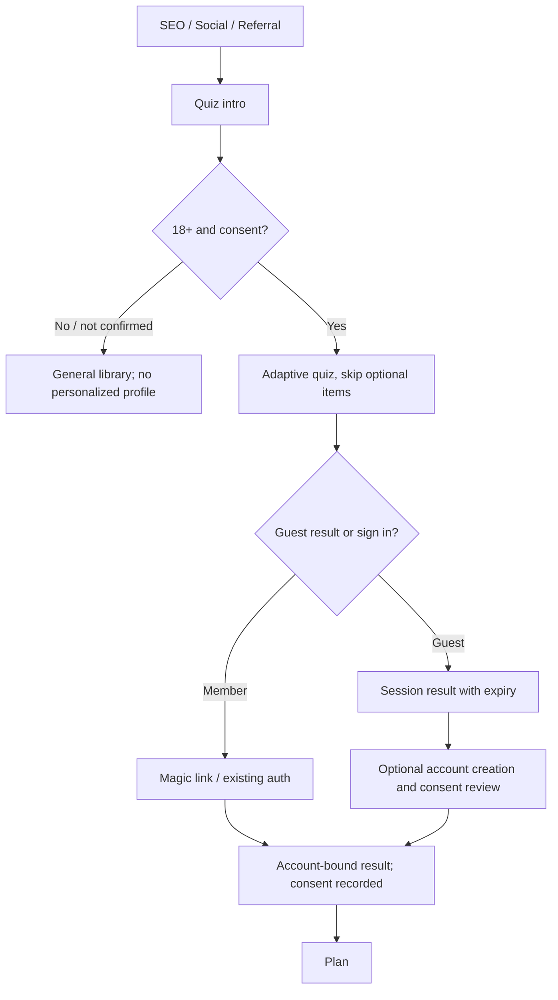
End states: general browsing, guest preview, or member result; conversion never silently transfers sensitive answers.

## UF02 Ebook → Quiz
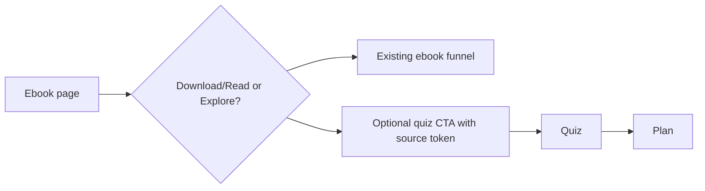
Attribution token excludes email/answers; consent for marketing, analytics, profile remains separate.

## UF03 Quiz → Personalized Plan
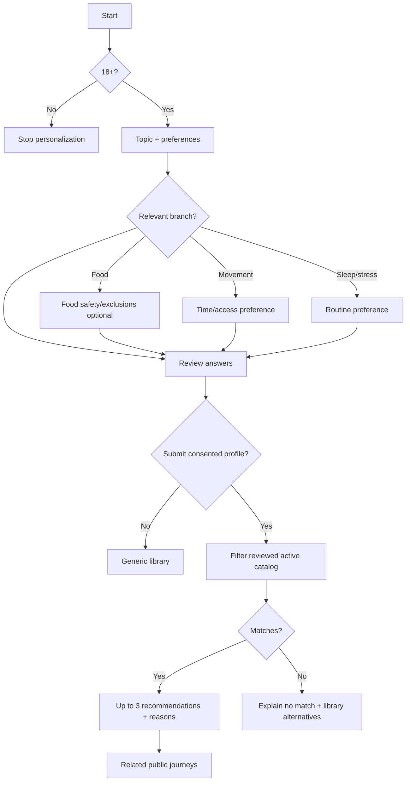

## UF04 Plan → Wellness World
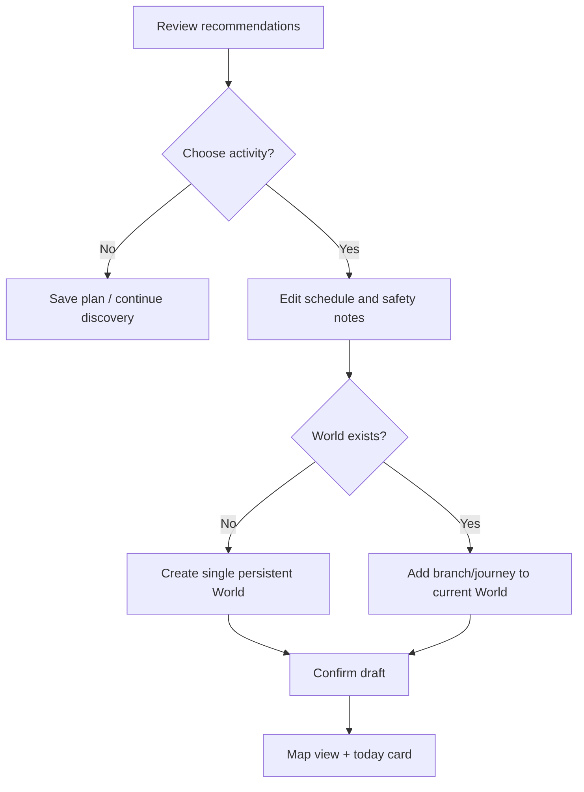

## UF05 Daily Journey
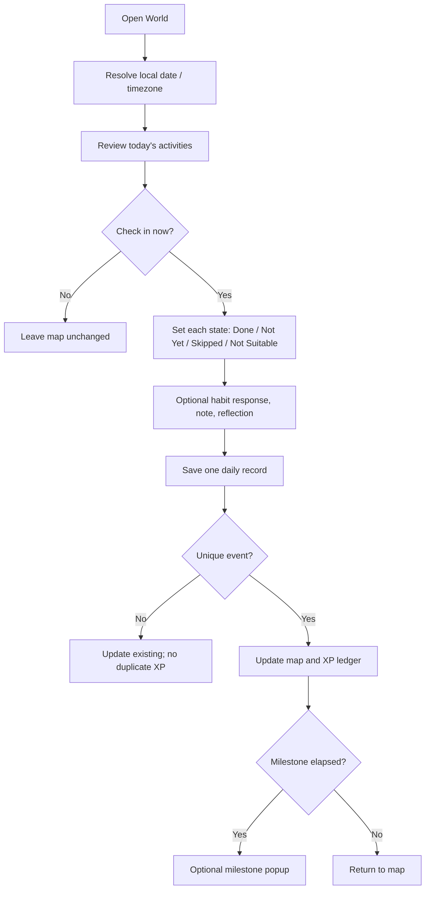

## UF06 Add Activity (including Day 14)
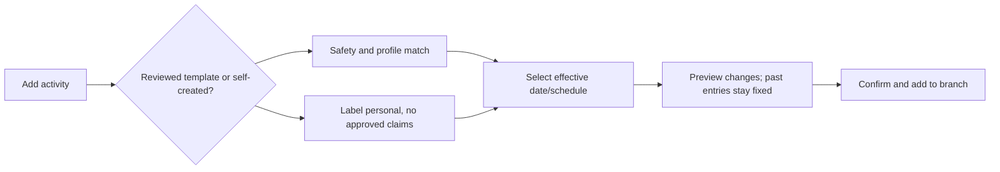

## UF07 Milestone Rewards
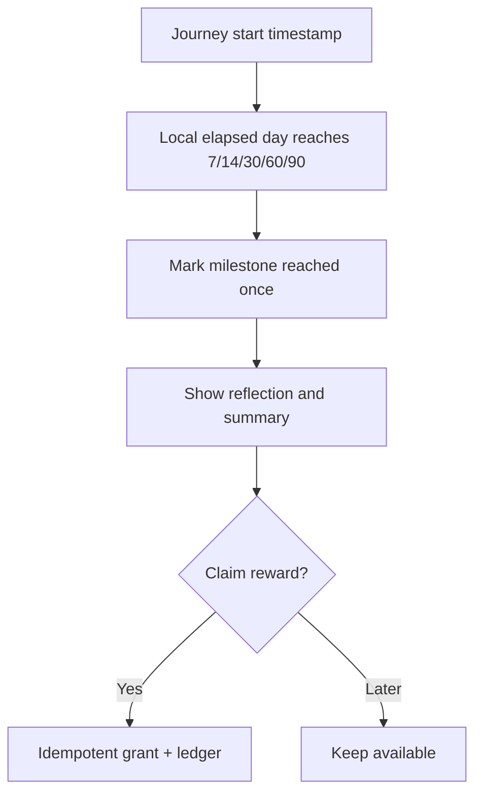
No daily check-in requirement on milestone date. No streak penalty.

## UF08 Public Journey Sharing
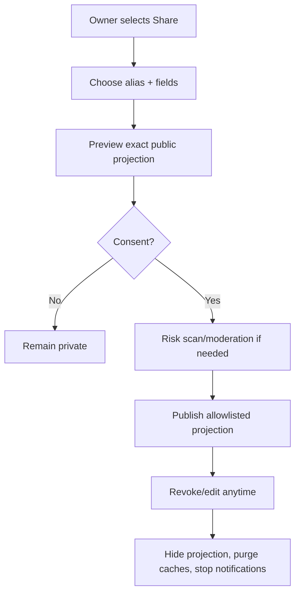

## UF09 Follow & Start My Own Journey
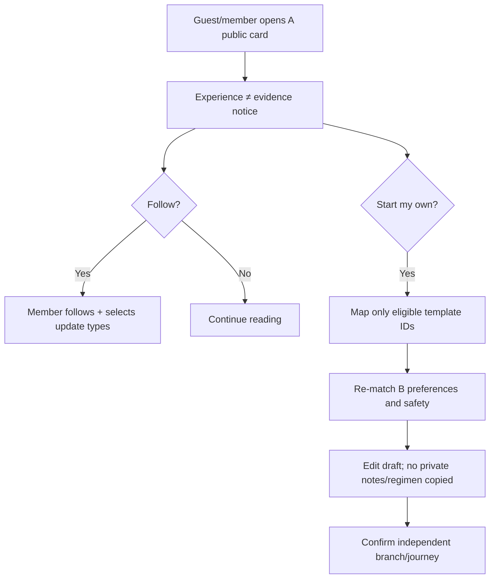

## UF10 Daily Email Return
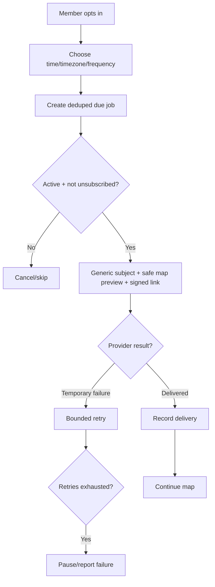

## UF11 Profile Deletion
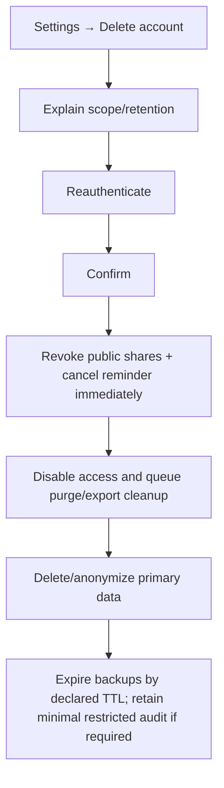

## UF12 Admin Review
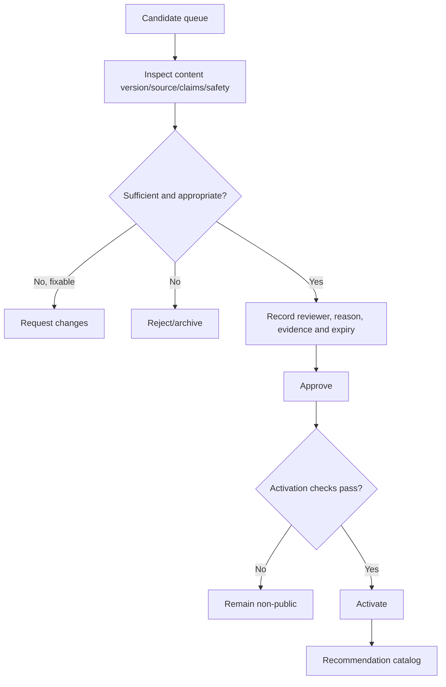

## UF13 Game onboarding → result → slot selection
Welcome → Choose Your Quest → Discover Your Lifestyle → Personalized Safety & Preferences → Unlock Your Wellness Toolkit → Equip Starting Tools → Enter Your Wellness World. Target 8–10 core questions with adaptive branches. Guest sees result before auth. Then choose zero to three tools across typed slots or skip all, create/continue one World, and reach first check-in. Back/Skip/Resume preserve explicit answers; missing safety info filters affected tools.

## UF14 Journey Combo partial acceptance
## UF15 Owner demo: verified email activation → persistent World — implemented and browser-verified 2026-10-29

`/play` → Welcome → Sleep Quest → maximum-ten-question discovery Quiz → short Reveal → read-only World Preview (no private World API access) → Start Your Journey → explicit profile/World consent → encrypted HttpOnly pending-journey cookie → Supabase local Auth OTP email captured by local Mailpit → confirmation link redirects to the HealthClues callback → callback verifies the Supabase user and matches the pending email/context → in-game Backpack → equip or skip all three slots → idempotent World creation → `/play` reload resumes the same World ID.

The owner demo uses a dedicated local Supabase project and persistent demo volume. The REST OTP redirect must be sent as the GoTrue `redirect_to` query parameter; placing the SDK-only `options.email_redirect_to` object in REST JSON caused confirmation to fall back to the Botly site root. Hosted email providers and external delivery remain unverified. See `reports/OWNER_PLAYABLE_AUTH_ACCEPTANCE.md` and `CURRENT_STATE.md` for actual test results and run commands.

Select approved Journey Combo → display components in Consume/Eat, Reduce/Avoid, Do/Practice → show reason/source/version/safety per component → accept all, accept subset, replace or skip → recheck version/compatibility → explicit confirm and create separate Toolkit Entries. If a component is stale/ineligible, apply reviewed partial policy; never invent a substitute or auto-equip. Recipe Combo remains a distinct recipe item linked to multiple ingredient IDs and a reviewed method.
# Luồng được duyệt mới nhất — 2026-10-28

## First Journey (approved; implementation partial)

`/play` → chọn Sleep Valley hoặc HealthClues Realm → eligibility/consent và Discovery Quiz (tối đa 10 câu theo product decision) → Reveal ngắn → read-only Overworld Preview → activation chỉ khi người chơi bắt đầu persistent journey → Backpack optional → persistent World → region tương ứng. Sleep đi với Luna; Health dùng concern/goal đã chọn trong Quiz và Lumi, không hỏi lại. Chi tiết Auth/pending-state yêu cầu ở `DECISIONS_AND_ASSUMPTIONS.md`; trạng thái thật xem `CURRENT_STATE.md`.

## Returning player (approved; local isolated email activation verified 2026-10-29, hosted provider not verified)

`/play` → resolve identity/state → resume cùng World/Journey nếu đủ điều kiện; không tạo World trùng, không lặp Quiz. Đổi account phải xóa hoặc cô lập client state theo identity. Browser mock callback E2E không chứng minh provider email lifecycle.

Map navigation, in-region learning/Toolkit/Companion flows là mục tiêu đã duyệt; không đánh dấu thực hiện chỉ từ flow diagram này.

## 09B implementation evidence — 2026-10-29

On the current isolated owner build, a saved authenticated `/play` opens the global map scene rather than the former scrolling V1 dashboard. The global map keeps all eight IDs; Sleep Valley and the stable `health-concern` presentation (HealthClues Realm) can enter detailed scene views, while six locked regions remain non-playable. Health topic display is loaded from the existing owner-scoped discovery profile; a Gout Quiz selection was browser-verified to continue into HealthClues Realm without a second topic prompt. This is verified presentation continuity, not yet a canonical normalized Journey entity or per-Journey loadout implementation. See `reports/OWNER_TWO_REGION_GAMEPLAY_ACCEPTANCE.md`.

## UF15 First-time Pet guide — implemented slice (2026-10-29)

After verified activation and creation/resume of the player's single World: load the Quiz-selected region → Pet welcome → NEXT opens Adventure Camp/Backpack → explore matching reviewed tools or skip → Pet points to the in-region Knowledge Library → continue to free exploration. SKIP GUIDE is always available. Guide state is keyed by authenticated user and World; refresh resumes the active step, completed/skipped stages do not force returning players through onboarding. The guide stores no Quiz answers or health concern. Catalog/Knowledge empty states are honest and non-blocking. Quick Preview/full details are implemented but await a matching reviewed demo Catalog item for browser verification. Evidence: `reports/FIRST_TIME_PLAYER_UX_ACCEPTANCE.md`.

## 09C ? Region discovery and private Care Plan implementation

Authenticated first-time flow in the current implementation: open the saved Sleep Valley or HealthClues Realm ? meet Luna/Lumi ? optionally follow Herbal & Nutrition Garden ? Activity Trail ? Wellness Sanctuary ? Backpack ? in-region Knowledge. Each step can be skipped; the guide stage is saved per owner and World. NPC stations query only the current reviewed Catalog API and filter by saved Journey tags; no match produces an honest empty state. A player may separately save an entry to Collection, request server-validated Backpack equip, or affirm they already use it and save a private USER-REPORTED record. Adventure Camp opens the separate Care Plan for user-entered methods and medication records. Care records do not enter equipment/check-in XP.

The detailed transitions, API checks and incomplete Daily Companion scope are recorded in `reports/HEALTHCLUES_09C_GAMEPLAY_ACCEPTANCE.md`.

## 09D-R — authenticated region exploration (verified slice, 2026-10-29)

After the existing verified-account flow resumes the selected region, the player can click/tap a walkable destination or landmark. The adventurer follows an interpolated route while the camera and Luna/Lumi follow. For NPC landmarks, no encyclopedia panel opens at a distance: the player first walks into the landmark approach point; only then does Talk appear. Talk opens the existing React station panel. Closing it returns to the preserved region position/camera. If a route cannot be found, movement stops and the player is asked to choose another destination. This behavior is browser-verified for the Sleep Valley NPC walk slice; full HealthClues Realm NPC travel and physical-device pinch remain unverified. Evidence: `reports/REAL_RPG_REGION_GAMEPLAY_ACCEPTANCE.md`.

## Optional Pet-led daily reflection — implementation slice (2026-10-29)

An authenticated player may open Daily Check-in from the in-game HUD. Luna/Lumi offers up to two optional, non-clinical reflection prompts; Skip conversation remains available. Answers remain in component state unless the player explicitly chooses **Add to private note**, after which the player can still edit the note before saving it through the existing private Check-in API. Existing per-tool status controls and privacy rules remain in place. This is a short guided check-in, not an AI chatbot or treatment-effect assessment. Browser evidence is recorded in `reports/HEALTHCLUES_FINAL_GAME_ACCEPTANCE.md`.

## Region travel update — safe movement and NPC approach (2026-10-29)

Within Sleep Valley or HealthClues Realm, pointer/touch destination clicks and keyboard movement use the same authored walkable network and route solver. Invalid or disconnected destinations are rejected with no direct-line fallback. To use an NPC or landmark, the player walks to its validated approach point first; Talk/Interact appears only on arrival. Opening/closing a gameplay panel preserves the current region position. Water and scenery destinations, bridge routes, keyboard block behavior and both region NPC journeys are exercised by the isolated owner-demo Chromium test. The corridor authoring and physical-device/mobile behavior remain partial; do not represent this as a fully accurate collision mesh.

## Optional in-map Knowledge mini-games and Skills — 2026-10-29

After entering the authenticated Knowledge Library, a player may open one of four short learning-only activities. Each is optional, replayable, and retryable without penalty. Completion is saved once per player/activity; the player can leave or close at any step. Four shared Skills are displayed in the current map context and derive from durable unique learning completions; switching Sleep/Health Journeys does not reset them. The local owner demo marks synthetic activities TEST ONLY / NOT HUMAN-REVIEWED. This flow is implemented in source but not yet verified in the rebuilt owner browser because Docker is stopped.

### Updated implementation and verification — 2026-10-30

The flow and all four unique completions are now browser-verified on isolated build `app-build-final-a7`; the four Skill counts survived `/play` reload. A separate regression test covers all five thresholds (0/1/3/5/8); the current browser fixture naturally demonstrates early levels only. Boss clear, Knowledge Key, boss World unlocks and the in-region Rewards observatory are also verified and persisted. TEST ONLY fixtures remain synthetic, non-clinical and not human-reviewed.

## Discovery to Backpack to Daily Companion — implementation update 2026-10-30

At Food & Botanical Garden, Activity Trail or Wellness Sanctuary, the player browses Journey-matched entries, opens preview/full details, then independently saves, self-reports, equips when eligible, or skips. Equip chooses one of three flexible positions; replacement requires confirmation. The private Daily Companion checklist can record Tried / Used, Not Yet, Skipped or Don't Remember for currently equipped tools. Collection and Care Plan remain separate. TEST ONLY fixtures are isolated to owner demo.
# Optional personalized discovery — 2026-10-30

After the original Quiz, Luna/Lumi can show up to three deterministic Catalog suggestions in Camp and station-specific suggestions on reaching an NPC. Cards explain why they appear, evidence/safety limits, and whether personal discovery/equipment is eligible. The player may explore by walking to the matching landmark, save independently to Collection, dismiss, or equip only when the server accepts eligibility. Free NPC Encyclopedia browsing remains available when no personal suggestion qualifies. No new mandatory Quiz questions or diagnosis are introduced.

### Phase 10A.2 browser verification — 2026-10-30

The previous note that the Plan browser round-trip was not verified is superseded. Chromium on the updated isolated build completed both Gout and Sleep Quiz → optional Plan → explicit confirmation → local email verification → World entry. Both saved Plan revisions remained attached to their respective World IDs after reload. A second account received a separate World; cross-account Plan read/write attempts were rejected. See `reports/HEALTHCLUES_PHASE_10A_ACCEPTANCE.md` for screenshots and unverified extended edge cases.

## Master Prompt 11 — World welcome → saved Plan → exploration (2026-10-30)

After authenticated activation, enter the existing selected Region and show the shared four-step Pet tutorial: welcome → actual saved goal preview (or truthful no-plan state) → open the existing Quests Plan → start exploring with one reachable landmark highlighted. Continue, Back and Skip persist through `/api/healthclues/guide`; completed/skipped guides do not reopen on reload, and the Pet help control permits voluntary replay. Step three's button and the top Quests navigation both open the same owner/World-scoped My Wellness Plan. Closing the Plan returns to tutorial step three without moving the player. After the tutorial, the player may walk to the existing NPC approach point; Talk appears only at arrival, and closing the NPC panel returns to the same region position. No station order is imposed by the tutorial.

## My Journey summary from either Region — 2026-10-31

From Sleep Valley or HealthClues Realm, the player can select the persistent `My Journey` route button directly below `World Map`. The compact view reads the current authenticated World’s Quiz focus and confirmed Plan goals, grouping active, saved-for-later and personal goals separately. `View Full Plan` opens the existing Quests panel. If there is no confirmed Plan, the player sees that state and may reopen saved Quiz suggestions without repeating the Quiz; those suggestions stay unconfirmed until the existing Plan flow explicitly saves a revision. The first-entry tutorial’s third step highlights the same control and its CTA opens the same summary. Reload uses the same World and Plan APIs; no new schema or duplicated Plan storage is introduced.
## Quests recovery for an unconfirmed Plan — implemented 2026-10-31

- In an authenticated World, Quests reloads the confirmed Plan from the owner-authorized Plan API using that World ID. It displays only the newest confirmed revision for that World.
- If the saved Quiz profile exists but no confirmed revision exists, Quests says there are no confirmed goals and offers to review suggestions using the existing profile. The player does not retake the Quiz. Closing or skipping the recovered Builder writes no Plan; only explicit confirmation creates a new revision.
- If Plan loading fails, show an error rather than the empty state. Missing Quiz profile is explained separately; never infer goals from suggestions or tutorial examples.

## Post-Quiz Gemini Advisor — implementation boundary — 2026-10-31

After the Quiz profile is formed, the Plan Builder posts its minimized structured profile to the local server-only Advisor route. In Owner Demo, an explicitly configured Gemini provider ranks/selects existing current reviewed Catalog candidates; the browser displays only validated items and keeps the existing Add/Adjust/Skip/Confirm and encrypted activation handoff. Request failures show `AI_UNAVAILABLE` and allow retry/continue without a generated list. No Plan is saved until the player confirms it. Real provider flow remains unverified while the private local Gemini file is absent.

## Interactive first-entry World tour — 2026-10-31

On the first eligible authenticated World entry, the region scene stays visible under a dimmed/blurred overlay. Luna or Lumi starts the tour. The player opens My Journey to see actual Quiz focus and current-World Plan groups; if no confirmed Plan exists, they can review saved Quiz suggestions without repeating Quiz or activating unconfirmed goals. Subsequent steps focus the actual Botanist and Wellness Guide targets, then return to the player for Start Exploring. Back/Skip/Replay and reload resume use the existing guide API and World-scoped state. Highlighting never bypasses movement or NPC proximity interaction.

## My Journey inventory icons — 2026-10-31

The same World flow now uses a coordinated Game-icons.net silhouette set for the My Journey navigation, Daily Checklist, Herbs Equipped and Practices Equipped, with CC BY 3.0 attribution and pinned source revision stored alongside the assets. It does not alter the authenticated data flow: current Quiz focus, confirmed Plan and NPC-origin equipment remain the only displayed sources. The three sections remain simultaneously expanded on desktop and mobile.

## My Journey flow (2026-10-31)

Trong Sleep Valley hoặc HealthClues Realm, người chơi mở `My Journey` ngay dưới `World Map`. Panel nạp focus và goal từ World đã xác thực, rồi liệt kê chỉ equipment trạng thái equipped theo NPC nguồn. Người chơi xem goal chi tiết qua `View Full Plan` để mở Quests chuẩn. Nếu chưa có Confirmed Plan, panel giải thích rõ và mở lại saved Quiz suggestions mà không làm lại Quiz. Tutorial Luna/Lumi spotlight icon, người chơi mở summary thật, xem lần lượt ba section, rồi tour chuyển tới Botanist và Wellness Guide thật. Reload giữ World và trạng thái trang bị; tour hoàn tất không tự lặp, nhưng Replay guide vẫn có.

### Focus mode cho tour My Journey

Khi người chơi mở My Journey từ tour, Pet giới thiệu theo thứ tự Wellness Focus → Daily Checklist → Herbs Equipped → Practices Equipped. Mỗi bước đặt lời thoại ngay trước mục thật, viền/glow đúng một mục, làm mờ ba mục kia và phủ tối toàn bộ map phía sau. Panel vẫn cuộn liên tục với ba inventory section luôn expanded; mobile tự cuộn mục và Pet vào vùng nhìn thấy. Back/Next đổi focus, Continue to the World đóng tour panel để tiếp tục các NPC hiện hữu. Lớp phủ World chặn thao tác map cho tới khi người chơi thoát/tiếp tục tour.

Trong phần hướng dẫn ba section của panel, Luna/Lumi giải thích từng section cạnh spotlight gắn với chính section đang được cuộn tới. Với người chưa xác nhận Plan, lời thoại chỉ nhắc Quiz focus và đường dẫn review; goal list vẫn rỗng. Các bước Herbs/Practices phân biệt lựa chọn trang bị với Collection và việc sử dụng. Chuyển bước không đóng hoặc thu gọn section; điều khiển Back/Next chỉ đổi section được spotlight. Tour ngoài panel tiếp tục dùng NPC thật và không tự mở hội thoại hay bỏ qua khoảng cách tương tác.

## English / Vietnamese first-entry locale ? 2026-10-31

### Existing account return to region NPCs — 2026-11-02

The returning-player path retains direct access to the original Quiz route with `?step=quest`; canonical IDs and answers remain the same across the two locale routes. Region names, map labels, NPC names/greetings, Talk/Interact actions, and movement help are presentation-localized. Locale switching does not rewrite stored Quiz values, region IDs, or catalog/NPC response content. Guest Quiz draft preservation and new local account NPC interactions are browser-verified; a previously populated authenticated 96-question account has not yet been exercised. The wider World remains only partially localized and must not be represented as fully translated.

On the existing Welcome screen the player selects English (default) or Ti?ng Vi?t, then starts the existing Quiz. Locale-specific routes share the same canonical Quiz IDs and answer values. A mid-Quiz language change preserves the current session draft and position. Before sign-in the preference is kept on the device; after sign-in the World loads/saves the locale through the authenticated profile endpoint. The existing Journey Settings surface exposes the selector.

Implementation evidence is partial: Welcome and shared route entry are browser exercised; full Quiz progression, account preference handoff, Pet tutorial, My Journey, NPC content and the rest of the player game still need end-to-end Vietnamese acceptance.

### Mid-Game HUD Language Switcher Flow — Cycle 34 (2026-11-08)
When a player is actively exploring the 2.5D village:
1. **User Action**: Clicks `.hc-rpg-lang-btn` in the top right HUD.
2. **Immediate UI Switch**: The HUD label changes from `VI` to `EN` (or vice versa).
3. **Dialogue Adaptation**:
   - If an NPC or Landmark talk prompt (`.hc-rpg-talk`) is open, its title, greeting, and action buttons (`Talk` / `Trò chuyện`) immediately re-render in the target language.
   - The companion Pet dialogue updates to the corresponding language.
   - All map location pills on the canvas re-render in English or Vietnamese without hardcoded strings.
4. **Backend Sync & URL Route**: The client sends `PATCH /api/healthclues/profile` saving `preferredLocale: nextLocale` to Postgres, and transitions URL between `/vi/wellness/healthclues/world` and `/en/wellness/healthclues/world` with query parameters preserved. Future sessions automatically start in the preferred language.
# Locale-aware Quiz Reveal and Wellness Plan Builder

The player may review the same canonical Quiz answers and goal choices in English or Vietnamese. Reveal and Plan Builder translate topic, selected interests, focus and region labels for display only. If no reviewed locale-appropriate sources are eligible, show a localized source-coverage explanation and keep the checklist empty; never surface a provider code or fabricate a suggestion. Confirm and continue actions remain available.

## Simplified bilingual Gemini checklist — 2026-11-02

The server sends the selected self-reported concern and concise onboarding answers to Gemini. Gemini returns up to six suggestions with localized title, short reason and two distinct A/B implementation options; it does not create IDs or Plan metadata. The server assigns language-independent IDs and keeps them bound to the profile through the existing Plan signature and persistence. The Builder supplies the checkbox and Custom option. The same bilingual suggestions are reused on an EN/VI switch without a new inference; only explicit retry requests a new plan. No fixed habit catalog or universal quantity is required, and the existing safety filter and short medical disclaimer remain. Only player-confirmed selections reach the existing Plan API. Offline synthetic evidence is in `reports/HEALTHCLUES_MASTER_PROMPT_17_ACCEPTANCE.md`; this change has not had a real Gemini acceptance call.

### Persisted display and returning-account verification — 2026-11-02

After the signed AI response is confirmed, the existing Plan revision retains the bilingual source copy alongside the selected A/B fields. My Journey uses the same saved goal ID and displays locale-appropriate title, reason and selected option on EN/VI changes; a reload reads the same data. Custom text remains user-authored. Old single-locale records preserve their original copy. Local Chromium verified this display and a returning authenticated synthetic World/Plan. Original 96-question answer preservation is not verified because the inspected legacy profile stores no answer array; do not force new onboarding or fabricate answers. See the current task section in `CURRENT_STATE.md` and `reports/HEALTHCLUES_MASTER_PROMPT_17_ACCEPTANCE.md`.

## Master Prompt 15 — guided My Journey spotlight behavior (2026-11-01)

The existing My Journey tutorial keeps all four real sections expanded and introduces Wellness Focus, Daily Checklist, Herbs Equipped and Practices Equipped in sequence. At each stop exactly one section receives the primary outline/glow; the other three are subdued. The real World is softly darkened and blocked behind the active dialog. Use the modal backdrop as the World dim layer so the actual Journey panel paints above it; do not use a body-level overlay that can out-stack the target content. Keep dialogue adjacent in normal panel flow. Auto-scroll within the Journey body to show the dialogue and target, preserve scrolling for long targets, and recalculate geometry when content or viewport changes. English/Vietnamese dialogue is presentation-only. No Quiz, Plan, inventory, World or tutorial persistence semantics change.

Implementation/browser evidence: reports/HEALTHCLUES_MY_JOURNEY_INVENTORY_ACCEPTANCE.md (isolated local Chromium, final build http://127.0.0.1:3296/play). Overall broader player localization remains PARTIAL.
# Master Prompt 16 — generated plan choice flow (2026-11-01)

Quiz → Reveal → server Advisor → localized personalized plan. Each validated goal presents its relevance and exactly two distinct AI action options plus one optional custom-text choice. No option starts selected. The player selects at most one choice per goal or skips it, reviews the selected-goal summary and confirms once through the existing Plan API. Cancel/continue with no goals creates no plan. My Journey reads the resulting confirmed Plan revision only. Gemini unavailable/402 shows a localized truthful state without deterministic content being labeled AI.

## MP17 new-player path — approved, not yet implemented end-to-end (2026-11-01)

Welcome/language → choose one self-reported wellness focus (optional concise text detail) → answer a few adaptive choice questions → existing verified account activation → choose/enter Sleep Valley or HealthClues Realm → Luna/Lumi welcome → optional in-World AI goal suggestions (independent include checkbox, A/B/custom implementation) → confirm zero or more goals, or postpone → existing My Journey and guide. Gemini errors must not prevent play and must not produce mocked advice. Existing onboarded users retain their current profile/World path and do not repeat the new discovery.

The implementation status below supersedes this initial approval snapshot: a new-player concern-first client, adaptive endpoint call, encrypted activation handoff and post-activation World Plan sequencing are now implemented and exercised through one synthetic Vietnamese account in isolated local Chromium. Adaptive responses in that test were intercepted synthetic fixtures, not AI output. Selected-goal persistence, two-account isolation, full bilingual World/NPC coverage and live Gemini remain unaccepted; see the latest dated checkpoint in the MP17 acceptance report.
## Optional goal-card guide visual — 2026-11-01

This was initially a visual-only slice in the legacy pre-World Plan Builder. The later MP17 implementation delta now also opens that existing Plan component in-World for new adaptive profiles after verified activation; the Pet copy remains a concise localized introduction and does not claim AI output when the Advisor is unavailable.

## MP17 implementation delta — 2026-11-01 (partial)

Implemented source flow for new profiles: Welcome/language → canonical focus choice → short adaptive questions → existing encrypted pending-journey handoff → verified email activation → selected existing playable World → Pet introduction → existing Plan panel → existing guide. Existing saved and resumed Quiz users retain the legacy `?step=quest` branch. Adaptive provider failure leaves the player able to continue into account activation/World without fabricated questions or goals. The source path and isolated fixture questions have focused browser work; authenticated persistence through Plan/My Journey and two-account isolation remain NOT ACCEPTED until Chromium evidence is recorded.
A verified Vietnamese magic link with `next=/play?activation=complete` now routes through the same HealthClues pending-journey ownership check as English, with the Vietnamese locale provider. Other account callback requests continue using the existing generic Botly account callback. Browser verification of this fix is pending.
## New-player onboarding correction — 2026-11-02

`/play` → localized Welcome → select Sleep Valley or HealthClues Realm from the intact eight-region map/card set → short adaptive discovery (sleep habits in Sleep Valley; concern/goal plus relevant habits in HealthClues Realm) → existing email verification and encrypted pending-journey callback → enter the persisted playable region directly. Do not route back through a second global-map choice. The global map remains available through the in-world navigation. Returning players resume their stored World. The legacy 96-question Quiz route is unchanged.
# MP20 new-player discovery override — 2026-11-02

After language and playable World selection, show exactly two discovery screens: (1) choose one world-relevant concern, optionally describe Other; (2) optionally select multiple concern-specific factors, None/Unsure, and a note. The bank is available locally and does not wait for Gemini. Continue through the existing activation handoff with World and profile intact, then enter the selected region directly. Returning players retain the existing resume/legacy Quiz path.

On first entry, direct the player to My Journey as the combined hub for personalized goal suggestions and chosen goals/items. Herb and practice previews route to their NPCs; selection/equipment occurs only through real NPC interaction and existing eligibility checks.

### MP20 activation handoff failure and retry
After Q2 and explicit consent, the existing encrypted pending-journey endpoint accepts the same canonical factor IDs and labels produced by the Quiz, including an empty selection. On validation, size, service or connection failure, keep the selected World and Quiz profile on the current preview and show a localized retry explanation. Send the verification email only after the secure handoff succeeds.

### 2026-11-03: pending-journey local secret resilience & localized mojibake fix
In local demo environments, `pending-journey` falls back to `SUPABASE_SECRET_KEY` when `HEALTHCLUES_PENDING_JOURNEY_SECRET` is unset, preventing transient HTTP 503 service unavailable errors during activation handoff. Error messages for validation (400), payload size (413), service unavailable (503) and network failures in `HealthCluesWorldPreview.tsx` have been restored to clean UTF-8 Vietnamese without question-mark corruption.

### First-entry checklist visibility — 2026-11-02
On verified new-player arrival, the existing first-entry effect opens My Journey; its personalized recommendation section must be first so checklist cards or truthful Advisor loading/error/retry feedback appear immediately. The same panel continues to contain followed goals and equipped content. Reopening My Journey/Backpack exposes the same recommendations and canonical Plan data; this source change does not itself verify browser visibility or persistence.

### Advisor-to-World checklist continuity

After the saved profile and selected World load, first entry opens My Journey with the existing real Wellness Advisor Plan Builder. The permanent My Plan route also opens that builder when a Quiz profile exists. Valid Advisor responses render generated goals; provider/validation failure presents its returned safe message, request reference, and manual Retry; zero accepted goals has an explicit empty state. The server's correlation logs distinguish stage and outcome without Quiz answers or credentials. The signed authenticated Plan API remains the only persistence source for followed goals. Successful per-goal saves update the same screen without hiding remaining recommendations; save failures preserve the operation's request key for retry.

### 2026-11-03: verified Quiz to World Advisor context

After account verification, merge the selected two-question Quiz profile into the verified account profile. Then create/enter the selected playable region and retain that selected region as the World entry route; an older active branch must not override the latest selection. The World Advisor reads the authenticated saved profile, checks it against the selected region and request context, and uses only account-scoped, context-matched cached output. Any mismatched result or Plan snapshot is blocked from the active view with a recoverable localized error.

### 2026-11-12 — Cycle 88: Mobile Onboarding Flow ERG/Fallback Refinement

In `healthclues-mobile`, players progress through Welcome → `1. Vùng` → `2. Khám phá` (Steps 1/2 & 2/2 with auto-scroll when toggling custom `"other"` concern input and persistent sticky bottom CTA) → `3. Kế hoạch`. While awaiting Gemini Advisor recommendations, players can optionally tap `"Dùng gợi ý nhanh ngay →"` to apply contextual local suggestions without blocking, toggle/adjust habits with `44x44` targets, or confirm directly via the sticky footer bar into `/(game)/world`.

### 2026-11-12 — Cycle 89: Mobile 2.5D World Exploration Visual Flow

Upon entering `/(game)/world`, players navigate the `HealthClues Realm` cobblestone plaza in `2.5D` diorama mode (toggleable via `world-25d-toggle`), can cycle `Ban ngày` / `Hoàng hôn` / `Ban đêm` / `Tự động` lighting (`world-atmosphere-toggle`), see 6 simulated living village adventurers (`Anna`, `Leo`, `Mia`, `Ben`, `Lily`, `Lucas`) wandering along authored roads with wellness greetings on tap, and see real-time online adventurers (`🟢 {nickname}`) with live coordinate sync and quick greeting interactions (Wave, Cheer, Offer Tea) alongside TopHud `onlineCount`.
