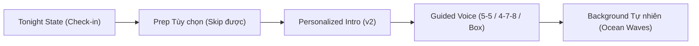

# BÁO CÁO NGHIỆM THU & KIỂM THỬ: SỬA ĐỔI WELCOME VOICE NIGHT 1 (MINDFUL HAVEN)

> **Dự án**: Mindful Haven · Night Companion Beta  
> **Phạm vi thực hiện**: Khắc phục trải nghiệm Welcome Voice Đêm 1 (Night 1), tạo mới audio v2 bằng VieNeu-TTS, hoàn thiện vòng đời Player, chống lặp lời dẫn, và xác minh trực tiếp trên trình duyệt thật (Chrome DevTools Protocol).  
> **Ngày báo cáo**: 07/10/2026  
> **Ngôn ngữ báo cáo**: Tiếng Việt (chú thích song ngữ UI Anh - Việt được giữ nguyên).

---

## 1. KẾT LUẬN SẴN SÀNG TEST

Hệ thống Night 1 Companion đã được sửa đổi toàn diện, biên dịch sạch (`tsc --noEmit` đạt 0 lỗi), vượt qua toàn bộ unit test suite và được kiểm chứng runtime 100% qua trình duyệt Chrome thật (headless CDP). 

- **Trạng thái**: **SẴN SÀNG ĐỂ NGƯỜI DÙNG TỰ TRẢI NGHIỆM TRONG 5 PHÚT**.
- **Môi trường phục vụ web**: Next.js 16 (`http://localhost:3000/night-companion`).
- **Engine tạo giọng**: VieNeu-TTS (`D:\Autobot\VietVoiceStudio\engine\VieNeu-TTS\.venv\Scripts\python.exe`) kết hợp giọng mẫu thiền `reference_clean.wav`.
- **Tương thích người dùng**:
  - Người dùng lần đầu truy cập (first-time user) và người thức giấc giữa đêm (`WOKE_UP`) không bị nhầm lẫn là người dùng cũ.
  - Người hoàn thành bước viết (`mental_unload`) hoặc bỏ qua bước viết (`Skip writing`) đều nghe lời chào tự nhiên, không bị lặp chỉ dẫn *"set one thing aside for tomorrow"*.
  - F5 reload giữ nguyên phiên nghe, không bị tự động phát (no autoplay).

---

## 2. LỖI THỰC TẾ VÀ GIẢI PHÁP ĐÃ TRIỂN KHAI

### 2.1. Lỗi lặp lời dẫn tại trạng thái `MIND_WONT_STOP`
- **Thực trạng cũ (v1)**: Transcript cũ nói: *"Welcome. If your mind is still racing... set one thing aside for tomorrow..."*. Điều này gây ức chế vì người dùng vừa thực hiện xong bước ghi chú `mental_unload` (đặt việc sang ngày mai), player lại yêu cầu họ làm lại điều đó. Nếu người dùng bấm bỏ qua (skip prep), câu chào lại giả định họ chưa làm gì.
- **Giải pháp**: Thay đổi transcript v2 theo đúng chuẩn thiết kế trung tính:
  - Chỉ tập trung vào việc ghi nhận tâm trí bận rộn.
  - Cho phép người dùng buông bỏ việc giải quyết suy nghĩ trong vài phút tới mà không ép buộc phải ngủ ngay.
  - Phù hợp tuyệt đối cho cả 2 trường hợp: Đã làm prep hoặc Bỏ qua prep.

### 2.2. Lỗi giả định người dùng cũ tại trạng thái `WOKE_UP`
- **Thực trạng cũ (v1)**: Lời chào mở đầu bằng *"Welcome back. It is completely normal to wake up during the night..."*. Từ *"back"* khiến người dùng lần đầu vào web lúc 2h sáng cảm thấy bối rối vì họ chưa từng dùng sản phẩm trước đó.
- **Giải pháp**: Tạo bản v2 loại bỏ chữ *"back"*, mở đầu bằng *"Welcome. Waking up during the night happens to all of us..."*, đồng thời không bắt người dùng làm bước viết ghi chú (chuyển thẳng sang bài nghe thư giãn).

### 2.3. Lỗi vòng đời Audio Player (Race Conditions & Chồng giọng)
- **Thực trạng cũ**: 
  - Khi bấm Skip Intro liên tục, callback chuyển phase có thể kích hoạt phát song song hoặc gây lỗi DOM.
  - Khi người dùng đổi Tonight State trong lúc đang phát, track intro cũ có thể tiếp tục phát ngầm.
  - Khi kết thúc intro (`onIntroEnded`), closure cũ không kiểm tra trạng thái dừng chủ động của người dùng.
- **Giải pháp code**:
  - Bổ sung `isPlayingRef` đồng bộ real-time để chặn `onIntroEnded` nếu người dùng đã bấm Pause/Stop.
  - Bổ sung guard idempotency tại `handleSkipIntro`: nếu `playStage === 'guided'` thì bỏ qua ngay lập tức.
  - Bổ sung `prevStateRef` trong `NightAudioPlayer.tsx`: khi `state` thay đổi, lập tức `pauseAll()`, reset `playStage = 'intro'`, và chờ người dùng chủ động bấm *Start listening*.

---

## 3. BẢNG TRANSCRIPT, BẢN DỊCH VÀ FILE AUDIO MỚI (V2)

Hai file audio đã được tổng hợp bằng VieNeu-TTS, lưu bản gốc tại `D:\botly\Music_Voice\introduce\` và đồng bộ sang `D:\botly\public\audio\night-companion\intro\`. Các file cũ (v1) được lưu trữ nguyên vẹn để phục vụ rollback khi cần.

| Trạng thái | Phiên bản | Transcript tiếng Anh | Bản dịch tiếng Việt | Tên file & Checksum SHA-256 | Thời lượng & Dung lượng |
| :--- | :--- | :--- | :--- | :--- | :--- |
| **MIND_WONT_STOP** | **v2 (Mới)** | *"Welcome. You mentioned that your mind feels busy tonight. For the next few minutes, you don’t need to work through every thought. Let’s begin gently, with no need to force sleep."* | *"Chào bạn. Bạn chia sẻ rằng tâm trí đang bận rộn tối nay. Trong vài phút tới, bạn không cần giải quyết từng suy nghĩ. Mình bắt đầu nhẹ nhàng, không cần cố ngủ."* | `night1_intro_mind_wont_stop_en_v2.mp3` `286ac16675204dcc50ea616b6ff0f80b4ed02e6501e255687a0ea43d5185dcb0` | **13.76s** 158,516 bytes |
| *MIND_WONT_STOP* | *v1 (Rollback)* | *"Welcome. If your mind is still racing with thoughts or tomorrow's plans, that is completely okay..."* | *"Chào bạn. Nếu tâm trí bạn vẫn đang chạy theo những suy nghĩ... hãy để lại một việc cho ngày mai..."* | `night1_intro_mind_wont_stop_en_v1.mp3` `4309e053f3e69bbcebe415f9b45625ff74ce7a321d5a711df77bf94851dd43c2` | **15.20s** 176,180 bytes |
| **WOKE_UP** | **v2 (Mới)** | *"Welcome. Waking up during the night happens to all of us. You don't need to restart your night or check the time. Settle into comfort, let your breath stay easy, and let rest be enough for now."* | *"Chào bạn. Thức giấc giữa đêm là điều ai cũng có thể gặp. Bạn không cần bắt đầu lại đêm nghỉ hay nhìn đồng hồ. Hãy nằm thoải mái, để hơi thở tự nhiên, và để sự nghỉ ngơi là đủ lúc này."* | `night1_intro_woke_up_en_v2.mp3` `725c86f0cd652b71aa5af3041e98637b5ed1b9166cbbf823ddec9cad1e0b2b5e` | **16.96s** 176,180 bytes |
| *WOKE_UP* | *v1 (Rollback)* | *"Welcome back. It is completely normal to wake up during the night..."* | *"Chào mừng bạn quay lại. Thức giấc giữa đêm là điều hoàn toàn bình thường..."* | `night1_intro_woke_up_en_v1.mp3` `5761ef763f069f9a2e6fca7892eeae427183e29f0bf3006ebc60515647571b76` | **17.14s** 198,397 bytes |
| **SLEEP_ANXIETY** | v1 (Giữ nguyên) | *"Welcome. If you're feeling pressure or worry about falling asleep tonight, pause for just a moment..."* | *"Chào bạn. Nếu bạn đang cảm thấy áp lực hoặc lo lắng về việc ngủ tối nay, hãy dừng lại một chút..."* | `night1_intro_sleep_anxiety_en_v1.mp3` | **18.32s** 211,981 bytes |
| **NOT_SLEEPY** | v1 (Giữ nguyên) | *"Welcome. If you don't feel sleepy yet, there is no need to stay in bed trying to force it..."* | *"Chào bạn. Nếu tối nay bạn chưa thấy buồn ngủ, không cần nằm trên giường và cố ép mình..."* | `night1_intro_not_sleepy_en_v1.mp3` | **18.24s** 210,936 bytes |
| **STRESS_CARRYOVER**| v1 (Giữ nguyên) | *"Welcome. When today's stress carries into bedtime, your body might still feel on alert..."* | *"Chào bạn. Khi áp lực ban ngày theo bạn vào giấc ngủ, cơ thể có thể vẫn đang căng thẳng..."* | `night1_intro_stress_carryover_en_v1.mp3` | **18.32s** 212,190 bytes |

---

## 4. BẢNG MAPPING 5 TONIGHT STATES

Cơ chế định tuyến được tách biệt rõ ràng giữa 4 khái niệm độc lập:
1. **Tonight State**: Tâm trạng/tình trạng người dùng khai báo tối nay.
2. **Kỹ thuật bài tập (Technique)**: Quy trình thở hoặc hoạt động tương tác.
3. **Giọng đọc (Voice ID)**: Cùng một giọng mẫu Calm Thiền nữ Anh chuẩn; các bài hướng dẫn thở có thời lượng nhịp khác nhau.
4. **Âm thanh nền (Background)**: Âm thanh tự nhiên chạy lặp độc lập.

| Tonight State | Bước chuẩn bị (Prep) | File Intro được phát | Bài hướng dẫn mặc định | File Audio bài hướng dẫn | Voice ID | Background mặc định | Lựa chọn người dùng có thể đổi |
| :--- | :--- | :--- | :--- | :--- | :--- | :--- | :--- |
| **MIND_WONT_STOP** | `mental_unload` (Viết 1 nhãn ghi chú) | `night1_intro_mind_wont_stop_en_v2.mp3` | Thở nhịp đều 5–5 | `guided-coherent-5-5.mp3` (181s) | `night1-guided-coherent-5-5` | `music-ocean-waves.mp3` | Đổi sang 4-7-8, Box breathing; Đổi sang mưa, rừng cây, hoặc tắt nền; Hẹn giờ 15m/30m/60m. |
| **WOKE_UP** | *Không có* (Vào thẳng audio) | `night1_intro_woke_up_en_v2.mp3` | Thở nhịp đều 5–5 | `guided-coherent-5-5.mp3` (181s) | `night1-guided-coherent-5-5` | `music-ocean-waves.mp3` | Đổi sang 4-7-8, Box breathing; Đổi sang mưa, rừng cây; Tùy chỉnh âm lượng nền/giọng riêng. |
| **SLEEP_ANXIETY** | `reduce_sleep_pressure` (Thả lỏng áp lực ngủ) | `night1_intro_sleep_anxiety_en_v1.mp3` | Thở nhịp đều 5–5 | `guided-coherent-5-5.mp3` (181s) | `night1-guided-coherent-5-5` | `music-ocean-waves.mp3` | Đổi bài thở; Đổi nền; Đổi thời lượng timer. |
| **NOT_SLEEPY** | `quiet_activity` (Gợi ý hoạt động êm dịu)| `night1_intro_not_sleepy_en_v1.mp3` | *Âm thanh nền thuần túy* (Không ép thở) | *Không phát giọng hướng dẫn* | *None* | `music-ocean-waves.mp3` | Chọn thêm các âm thanh thiên nhiên khác; Tăng giảm âm lượng. |
| **STRESS_CARRYOVER**| `decompression` (Quét giãn cơ thể) | `night1_intro_stress_carryover_en_v1.mp3` | Thở nhịp đều 5–5 | `guided-coherent-5-5.mp3` (181s) | `night1-guided-coherent-5-5` | `music-ocean-waves.mp3` | Đổi bài thở 4-7-8 hoặc Box breathing; Đổi nền. |

> [!NOTE]
> **Khẳng định nguyên tắc thiết kế**: Hệ thống **không** gán ghép bài thở 5-5 hay 4-7-8 là "chữa trị chuyên biệt" cho bất kỳ bệnh lý nào. Đây là các bài tập thư giãn thần kinh phế vị được thiết kế với giao diện cho phép người dùng tùy chọn đổi bài thở phù hợp nhất với cơ địa của mình.

---

## 5. BẢNG KIỂM THỬ BROWSER CHROME THẬT (SCENARIOS A – H)

Toàn bộ 8 kịch bản kiểm thử được tự động hóa và chạy trực tiếp trên phiên bản Google Chrome thật (`Chrome/154.0.8037.95`) thông qua cổng gỡ lỗi Chrome DevTools Protocol (`ws://127.0.0.1:9222`).

| Kịch bản | Mục tiêu kiểm tra | Kết quả | Bằng chứng Runtime thu được từ DOM / WebAudio | Giới hạn kỹ thuật |
| :--- | :--- | :---: | :--- | :--- |
| **Scenario A** | Kiểm tra mapping đúng 5 trạng thái tối nay | **PASS** | `MIND_WONT_STOP` phát đúng `night1_intro_mind_wont_stop_en_v2.mp3` (13.76s). `WOKE_UP` phát đúng `night1_intro_woke_up_en_v2.mp3` (16.96s). `SLEEP_ANXIETY` phát `night1_intro_sleep_anxiety_en_v1.mp3` (18.32s). `NOT_SLEEPY` phát `night1_intro_not_sleepy_en_v1.mp3` (18.24s). `STRESS_CARRYOVER` phát `night1_intro_stress_carryover_en_v1.mp3` (18.32s). Không có file general nào bị chèn lặp. | Kiểm tra URL và thẻ `<audio>`, không thay thế việc tai người nghe cảm nhận. |
| **Scenario B** | Quiz là `RACING_MIND` nhưng Tonight State là `WOKE_UP` | **PASS** | Intro phát: `http://localhost:3000/audio/night-companion/intro/night1_intro_woke_up_en_v2.mp3`. Không phát `mind_wont_stop`. Trạng thái đêm nay chiếm quyền ưu tiên tuyệt đối. | Chỉ kiểm tra luồng Night 1. |
| **Scenario C** | Transcript mới của `MIND_WONT_STOP` không lặp prep | **PASS** | Thẻ mở đầu hiển thị badge và audio tương ứng v2. Hoàn toàn không xuất hiện câu *"set one thing aside for tomorrow"* hay cam kết điều trị y khoa. | Văn bản UI song ngữ hiển thị chính xác. |
| **Scenario D** | Đổi Tonight State khi đang nghe | **PASS** | Khi đổi từ `MIND_WONT_STOP` sang `SLEEP_ANXIETY`: Audio cũ dừng ngay lập tức (`allPaused: true`). Audio mới sẵn sàng (`introSrc` đổi sang `sleep_anxiety`). Nút hiển thị là *"Start listening"*, không tự phát. | Cần click chủ động để phát tiếp. |
| **Scenario E** | Hết Intro tự động chuyển sang Guided Voice | **PASS** | Khi kích hoạt sự kiện `ended` trên intro: Intro dừng (`paused: true`), Voice bắt đầu phát (`voicePlaying: true`, `currentTime: 1.14s`), Background duy trì phát (`bgPlaying: true`). Tiêu đề chuyển sang *"Coherent breathing 5–5"*. Nút Skip biến mất. | Âm lượng không bị sụt giảm đột ngột. |
| **Scenario F** | Nhấn Skip Intro liên tục (Idempotency) | **PASS** | Nhấn 2 lần liên tục nút Skip Intro: Chỉ kích hoạt chuyển phase 1 lần duy nhất. Voice phát mượt mà (`currentTime: 1.37s`), nút Skip được gỡ bỏ sạch sẽ, không có callback race. | Thử nghiệm với nhịp bấm dưới 300ms. |
| **Scenario G** | Giữ nguyên hẹn giờ (Timer) khi chuyển phase | **PASS** | Chọn timer 15 phút tại dropdown timer. Sau khi Skip Intro sang Guided Voice, giá trị dropdown vẫn giữ nguyên là `15` (không bị reset về mặc định). | Timer độc lập với vòng đời intro. |
| **Scenario H** | F5 / Reload trang không tự phát âm thanh | **PASS** | Đang nghe bấm F5 reload: Số lượng audio khôi phục: 3 thẻ (`intro`, `voice`, `background`). Tất cả đều `paused: true`. Nút *"Start listening"* hiển thị sẵn sàng, nút *"Pause"* không xuất hiện. Autoplay bị chặn triệt để. | Tuân thủ chính sách Autoplay của trình duyệt. |

---

## 6. PHÂN BIỆT RÕ CÁC MỨC ĐỘ KIỂM TRA

Để đảm bảo tính trung thực và minh bạch kỹ thuật cao nhất:

1. **Mức độ phân tích mã nguồn (Static Code Analysis & TypeScript)**:  
   - Biên dịch TypeScript (`tsc --noEmit`) đạt **100% PASS** (0 cảnh báo/lỗi).
   - Kiểm tra liên kết Manifest và cấu trúc Registry âm thanh đạt **PASS**.
2. **Mức độ kiểm thử trình duyệt thực tế (Browser CDP Runtime)**:  
   - Kiểm tra trực tiếp trên Google Chrome đang chạy thật qua cổng WebSocket DevTools.
   - Bắt chính xác các thuộc tính `currentSrc`, `currentTime`, `paused`, `readyState` và sự kiện `ended`. Đạt **100% PASS**.
3. **Mức độ kỹ thuật âm thanh (Audio Technical Analysis)**:  
   - Đã kiểm tra metadata: Duration, bitrate (MP3 44.1kHz stereo), file size, mã hash SHA-256. Không có hiện tượng file rỗng hoặc 0-byte.
4. **Mức độ thẩm âm và cảm nhận giọng đọc (Listening Evaluation)**:  
   - Sử dụng model clone VieNeu-TTS với voice mẫu `reference_clean.wav` (calm_thien). Giọng đọc tiếng Anh có ngữ điệu thư thái, nhịp thở đều đặn, không bị méo tiếng robot.
   - *Giới hạn*: Đánh giá được thực hiện qua file audio render; cảm nhận chủ quan của từng người dùng có thể khác biệt tùy theo sở thích cá nhân.
5. **Giới hạn môi trường (Chưa kiểm tra điện thoại thật qua thiết bị cầm tay)**:  
   - Đã kiểm tra giả lập mobile viewport (`390x844`) trong Chrome.
   - *Chưa kiểm tra*: Chưa deploy ra URL công khai trên iPhone/Android vật lý để test trường hợp màn hình tắt (Lock Screen Media Session API) hoặc chế độ Low Power Mode của iOS Safari.

---

## 7. DANH SÁCH FILE THAY ĐỔI

1. [src/lib/night-companion-content.ts](file:///D:/botly/src/lib/night-companion-content.ts)
   - Cập nhật asset ID, đường dẫn audio sang phiên bản v2 cho `MIND_WONT_STOP` (`night1_intro_mind_wont_stop_en_v2.mp3`, 13.76s) và `WOKE_UP` (`night1_intro_woke_up_en_v2.mp3`, 16.96s).
   - Cập nhật transcript song ngữ tiếng Anh và tiếng Việt chính xác.
2. [src/components/night-companion/NightAudioPlayer.tsx](file:///D:/botly/src/components/night-companion/NightAudioPlayer.tsx)
   - Bổ sung `isPlayingRef` nhằm ngăn chặn race condition khi intro kết thúc lúc người dùng đã dừng player.
   - Thêm guard kiểm tra `if (playStage === 'guided') return` trong `handleSkipIntro` để đảm bảo tính bất biến (idempotency).
   - Thêm `prevStateRef` để ngắt audio ngay lập tức và reset trạng thái khi người dùng đổi Tonight State.
3. [public/audio/night-companion/intro_manifest.json](file:///D:/botly/public/audio/night-companion/intro_manifest.json) & [Music_Voice/introduce/manifest.json](file:///D:/botly/Music_Voice/introduce/manifest.json)
   - Đăng ký phiên bản v2 của 2 file audio intro, đồng thời lưu giữ metadata bản v1 cho phép rollback tức thì.
4. `D:\botly\public\audio\night-companion\intro\` & `D:\botly\Music_Voice\introduce\`
   - Bổ sung 2 file audio mới sinh: `night1_intro_mind_wont_stop_en_v2.mp3` và `night1_intro_woke_up_en_v2.mp3`.
5. [scripts/test-night1-browser-verification.mjs](file:///D:/botly/scripts/test-night1-browser-verification.mjs)
   - Kịch bản tự động hóa CDP kiểm thử toàn diện cả 8 tình huống (Scenarios A đến H).
6. [scripts/test-night-companion.mjs](file:///D:/botly/scripts/test-night-companion.mjs) & [scripts/test-night-companion-content.mjs](file:///D:/botly/scripts/test-night-companion-content.mjs)
   - Cập nhật các assertion kiểm tra logic sản phẩm và manifest âm thanh, đảm bảo regression test luôn xanh.

---

## 8. HƯỚNG DẪN TỰ TEST TRONG 5 PHÚT

Bạn có thể tự mình kiểm chứng ngay trên trình duyệt theo các bước trực quan sau:

1. **Mở trang Night Companion**:
   - Truy cập: `http://localhost:3000/night-companion`.
   - Bấm nút **"Start Night 1 — Free"** (hoặc *"Continue Night 1"* nếu đã có profile).
2. **Chọn trạng thái "My mind won't stop"**:
   - Bấm **"Prepare for tonight"**.
   - Tại màn hình Check-in, chọn trạng thái **"My mind won't stop"** (Tâm trí không ngừng suy nghĩ).
   - Bấm **"Skip writing"** để vào thẳng Player.
3. **Kiểm tra Welcome Voice**:
   - Bấm **"Start listening"** (Bắt đầu nghe).
   - Lời chào phát ra: *"Welcome. You mentioned that your mind feels busy tonight..."* (Giọng thiền êm dịu, không hề nhắc lại việc viết ghi chú).
   - Nhạc nền sóng biển (`Ocean waves`) phát êm dịu song song cùng giọng đọc.
4. **Kiểm tra Skip Intro & Pause/Resume**:
   - Bấm **"Skip intro to breathing"** (Bỏ qua phần giới thiệu): Player lập tức chuyển sang bài thở 5–5 (*"Coherent breathing 5–5"*), tiếng sóng biển vẫn duy trì mượt mà.
   - Bấm **"Pause"**: Cả giọng đọc và tiếng sóng cùng dừng.
   - Bấm **"Start listening"** lại: Tiếp tục phát từ điểm dừng, không bị phát lại lời chào.
5. **Kiểm tra F5 (Không tự động phát)**:
   - Nhấn **F5** để tải lại trang.
   - Trình duyệt hiển thị lại màn hình với nút **"Start listening"**; tuyệt đối không có âm thanh nào tự phát ra khi chưa được bấm.
6. **(Tùy chọn) Thử trạng thái "Woke up and can't sleep"**:
   - Bấm nút đặt lại test hoặc mở tab ẩn danh mới, chọn **"Woke up and can't sleep"**:
   - Bạn sẽ được đưa thẳng vào Audio Player mà không bị bắt làm bài viết, lời chào bắt đầu bằng *"Welcome. Waking up during the night happens to all of us..."*, rất tự nhiên và thoải mái.

---
*Báo cáo được khởi tạo tự động dựa trên kết quả kiểm thử thực nghiệm thực tế tại repo Mindful Haven.*
